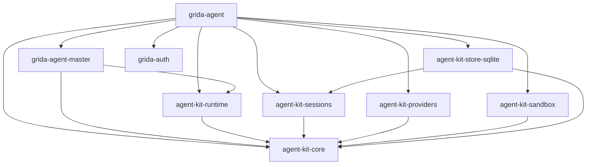
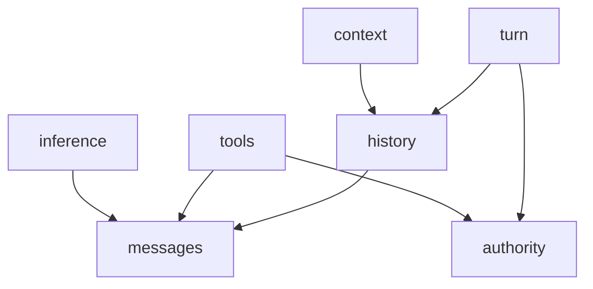

# Rust agent core

This document binds the responsibilities in the [component
specification](https://grida.co/docs/wg/ai/agent/components) to the Rust
crates that implement them. The [master specification](https://grida.co/docs/wg/ai/agent/master)
owns product strategy and the [experience
specification](https://grida.co/docs/wg/ai/agent/experience) owns user-visible
promises. The [feature catalog](../../../docs/agent/features.md) owns
release availability.

Each crate's README and rustdoc are the authority for exact public signatures,
record fields, and error codes. This document names the owning crate and its
principal types, and states the cross-crate rules those signatures preserve.

## Crate map

Each boundary is a Cargo package. Arrows in the graph below point from a
consumer to its normal dependency.

| Crate                                                              | Owns                                                                                                                                    |
| ------------------------------------------------------------------ | --------------------------------------------------------------------------------------------------------------------------------------- |
| [`agent-kit-core`](../../agent-kit-core/README.md)                 | Messages, Inference and Tool contracts, History, Context, turn journal records, authority references, driver state, and the error model |
| [`agent-kit-runtime`](../../agent-kit-runtime/README.md)           | The live turn: admission gate, concurrent scoped operations, waits, suspension, and settlement                                          |
| [`agent-kit-sessions`](../../agent-kit-sessions/README.md)         | Durable input acceptance, queue and controls, claims, recovery, and the injected turn driver                                            |
| [`agent-kit-providers`](../../agent-kit-providers/README.md)       | Chat Completions-compatible, Responses, Anthropic Messages, and Gemini adapters over a host-owned streaming transport                   |
| [`agent-kit-sandbox`](../../agent-kit-sandbox/README.md)           | Native confinement for raw processes: Seatbelt on macOS, bubblewrap with a seccomp helper on Linux                                      |
| [`agent-kit-store-sqlite`](../../agent-kit-store-sqlite/README.md) | The SQLite `SessionStore` and `TurnJournal`, with its session catalog, history replay, and session deletion                             |
| [`grida-agent-master`](../../grida-agent-master/README.md)         | Grida product policy: context selection, effort, goals, questions, subagents, lifecycle hooks, and completion accounts                  |
| [`grida-agent`](../README.md)                                      | The native executable and host composition: ACP and MCP bindings, configuration, permissions, tools, processes, and credentials         |



The master depends on Runtime and the shared core only. It receives sessions,
storage, providers, and execution through capabilities its host supplies.
`grida-auth` provides credential custody to the host and to no neutral crate.

Inside the shared core, these logical import directions hold.



### Dependency budgets

| Boundary          | Dependency budget                                                      | Keep outside it                                                                       |
| ----------------- | ---------------------------------------------------------------------- | ------------------------------------------------------------------------------------- |
| Shared core       | Values, serialization, futures/cancellation contracts, pure transforms | Concrete HTTP, SQLite, keyring, filesystem, UI, and Grida policy                      |
| Pure core modules | Explicit input data and deterministic computation                      | Runtime handles, clocks, network calls, and service state                             |
| Runtime           | Shared core, execution coordination, timing and concurrency utilities  | Sessions implementation, concrete providers, databases, and product decisions         |
| Sessions          | Shared core, injected driver/store contracts, service coordination     | Runtime implementation, model requests, and tool arguments                            |
| Provider adapters | Shared core and selected transport/authentication dependencies         | Product model defaults, task strategy, and session scheduling                         |
| Sandbox           | Shared core authority contracts and platform-specific dependencies     | Grant decisions, product policy, and network routing                                  |
| SQLite adapter    | Shared core, Sessions, and database dependencies                       | Model execution, tool execution, and product policy                                   |
| Product master    | Runtime and supplied capability contracts                              | Concrete server startup, databases, provider construction, process and terminal state |
| Native host       | Master, selected adapters, transport and process utilities             | A second task loop or separate unattended agent policy implementation                 |

Cargo enforces these boundaries between packages. Inside a package, a
`pub(crate)` helper must not become a hidden API between modules with separate
owners. Each such interaction needs a named capability or shared core contract.

Host composition owns the native driver that implements the Sessions contract
using Runtime. This preserves their sibling relationship: Runtime depends on
the shared core rather than on the service that drives it. The shared core
stays below Runtime and Sessions and never imports them. Persisted schema
identity is independent of Rust module paths, and public type moves require an
explicit compatibility review.

Inference receives a model-facing `ToolOffer`. Tools owns the executable
`ToolDefinition`. Runtime projects a captured definition into an offer and
retains their common identity and schema fingerprint. A direct Inference caller
needs no executor or session instance.

Further splits inside the shared core need a concrete reason: a platform that
needs a smaller dependency set, a separately maintained consumer with its own
compatibility contract, a substantial dependency that cannot stay in an
adapter, measured build cost, or repeated boundary violations. Cargo features
select optional integrations, not individual logical modules.
[Cargo features](https://doc.rust-lang.org/cargo/reference/features.html).

## Rust conventions

Pure data and logic use concrete structs, enums, and functions. Dynamic dispatch
is reserved for heterogeneous providers, tool executors, durable drivers, and
storage adapters. Those traits return boxed `Send` futures. This keeps them
usable behind `Arc<dyn Trait>` under Rust's dyn-compatibility rules.
[Rust Reference](https://doc.rust-lang.org/reference/items/traits.html#dyn-compatibility)

The shared core re-exports `BoxFuture` from `futures-core` and
`CancellationToken` from `tokio-util`. Native composition uses Tokio. Public
execution contracts expose futures and streams. A cancellation token signals a
request; settlement is a separate result. Messages, History, and Context expose
pure operations that need no running executor.
[CancellationToken](https://docs.rs/tokio-util/latest/tokio_util/sync/struct.CancellationToken.html)

Validated identifiers are distinct newtypes. Invalid or oversized wire values
fail at construction. Private fields protect prepared requests, captured
inventories, and bound execution handles. Durable encodings have explicit schema
identity and version. Rust struct layout and `Debug` output carry no persistence
contract.

A fingerprint is the SHA-256 of a value's canonical JSON: compact text with the
keys of every object, struct or map, in ascending byte order. Object insertion
order and field declaration order therefore never change it. A fingerprint is
written as 64 lowercase hexadecimal characters, and any other text is refused.
An envelope writes its schema, version and payload; the payload is padded
standard base64 of at most 8 MiB decoded.

### Error model

Every neutral crate returns `agent_kit_core::Result`, whose `Error` pairs one
`ErrorKind` with a stable machine-readable code. Display text is derived and
carries no contract.

| `ErrorKind`     | Meaning                                                                                 |
| --------------- | --------------------------------------------------------------------------------------- |
| `InvalidInput`  | The input is malformed or violates its own declared constraints                         |
| `Unsupported`   | The input is valid, but the receiving capability does not accept it                     |
| `Conflict`      | An expected position or revision moved, or an identity was reused for different content |
| `LimitExceeded` | A size, count, or numeric bound would be exceeded                                       |
| `InvalidState`  | The target's current state does not allow the requested transition                      |
| `Unavailable`   | A required capability or resource cannot be reached now                                 |
| `Uncertain`     | Whether an effect happened is unknown; the caller reconciles before repeating it        |

`Error` describes structural failures that prevent an operation or trustworthy
continuation. Ordinary model and tool failure, denied authority, and requested
stop remain outcome data so the master can account for them and finish. A
`Conflict` asks the caller to re-read current state before deciding whether to
retry. An `Uncertain` error keeps dependent execution suspended until readback
resolves it.

## Messages

`agent_kit_core::messages` owns content that can be retained, supplied to a model,
or projected to a client. Sessions owns queue state, the master selects models,
and execution accounting belongs to the turn. Storage connections stay in
adapters.

A `Message` has an identity, a role, an optional `MessagePhase` (`Progress` or
`Answer`), ordered `Content`, and `Provenance`. `Content` is text, readable
reasoning, a `MediaRef`, a `ToolCall`, a `ToolResult`, or an opaque
`ProviderState`. A `ToolCall` carries the call identity, the target `ToolId`,
and its `ToolArguments`, which are JSON or text.

`ToolResult` carries the original call identity, a bounded content view, and
artifact references. The execution ledger retains the authoritative outcome.
`MediaRef` carries content identity, media type, a locator, and its declared
lifetime and access scope. A resolver supplied by the host retrieves its bytes.
Resolution returns current availability tied to that content identity. A
retained path or descriptor alone is insufficient evidence that its bytes are
still retrievable.

`ProviderState` is a narrow opaque content envelope with producer identity,
format version, validity binding, and bytes. Provider adapters interpret it.
History can retain native compaction and continuation material without importing
Inference. Its binding contains lower-level identifiers and fingerprints,
including no request or turn types from higher modules. Provider request options
remain in Inference and its adapters.

`Provenance` distinguishes supplied content, observations, generated content,
transformations, and synthetic structural repair. Repairing a missing tool result
for a model request preserves the original execution uncertainty.

Readable reasoning has its own content kind. Signed, redacted, or encrypted
provider material retains its original envelope in `ProviderState`. An optional
assistant phase is an adapter-supplied semantic hint, and never establishes
terminal settlement. Provider protocols distinguish these kinds, and a
lossless round trip through History requires the same distinctions.

## Inference

`agent_kit_core::inference` executes one model request. Its model capability data
describes supported operations and limits. The master selects the model,
instructions, tool offers, model reasoning effort, fallback, and compaction strategy.

A `Provider` reports `capabilities` for a model, `prepare`s an
`InferenceRequest` into an immutable `PreparedRequest`, can measure the
complete prepared input (`measure_input` locally, `measure_input_async` within
an admitted request scope), and `start`s an `InferenceRun`. The run yields
`InferenceUpdate`s through `next` and its authoritative `InferenceOutcome`
through `finish`.

`prepare` performs capability and structural validation without dispatching a
request. `start` constructs an owned, poll-driven operation. An error from
`start` means dispatch has not begun. Once dispatch can have occurred, failures are
reported in `InferenceOutcome` with their evidence.

The adapter-facing module exposes
`PreparedRequest::from_validated(request, binding, extension)` for trusted
provider implementations after common and provider-specific validation.
`InferenceRun::from_stream` wraps adapter events with the shared terminal and
EOF checks. Adapter implementations therefore construct these values through
public factories while ordinary callers receive immutable prepared values.
Dispatch rechecks revocable access and the prepared principal binding.
The host authority binding also covers applicable endpoint, tenant, purpose,
and credential generation. The core retains an opaque binding identity and
validates compatibility through the host. Grida organization and billing
policy stay in the concrete host adapter.

| Value              | Required contents                                                                                                                                                     |
| ------------------ | --------------------------------------------------------------------------------------------------------------------------------------------------------------------- |
| `InferenceRequest` | Chosen model, exact messages, tool offers, output requirements, selected settings, input provenance                                                                   |
| `PreparedRequest`  | Immutable validated request, capability revision, request fingerprint, provider and principal binding                                                                 |
| `ToolOffer`        | Tool identity/version, model-visible name and description, input form/schema, streaming-input support                                                                 |
| `InferenceControl` | Cancellation token, attempt deadline, input/output bounds                                                                                                             |
| `InferenceUpdate`  | Text/content deltas, tool-input deltas, usage evidence, replacement-context updates                                                                                   |
| `InferenceOutcome` | Completion/limit/refusal/interruption classification, failure facts and retry advice, complete/partial items, usage, continuation, and dispatch and terminal receipts |

Successful transport completion, a complete model answer, output-limit truncation,
refusal, and an interrupted stream have distinct classifications. Failure facts
identify authentication/configuration problems, quota exhaustion, context limits,
rate limiting, transient availability, and invalid protocol data, with provider
code and retry-delay advice when available. They describe evidence, while the
master decides whether and when another attempt is justified.

Retry count, total retry time, and fallback selection are bounded master policy.
Runtime records attempts and cancelable backoff under the same turn and allowance.
A rejected credential or exhausted quota cannot become an endless transient
retry. Host-approved credential renewal keeps its principal binding. Hidden SDK
retries must be disabled or bounded and observable as separate physical attempts.

Output items preserve semantic kind so a client adapter can apply the master's
visibility policy before public serialization. Provider reasoning or continuation
material remains distinguishable from the public answer.

Usage observations identify the attempt, measurement source, category, unit,
and revision. Adapters normalize reports to cumulative quantities for an attempt.
A later revision replaces the earlier observation for that measurement, including
the terminal report. Replay preserves observation identity. Estimated, measured,
provisional, final, and unknown values stay distinguishable. Retries have separate
attempt identities. Host adapters supply pricing and authoritative charge records.

An adapter can report an immutable dispatch receipt as soon as it observes
one. Cancellation preserves that evidence. An observed terminal outcome
may carry a separate bounded receipt for facts learned at completion.
The core discards an oversized supplement and preserves the recorded
dispatch receipt and inference result.

`finish` consumes any remaining updates and validates terminal evidence. An
unexpected EOF becomes an interrupted outcome. Calling `next` until exhaustion
still requires inspecting `finish` for the authoritative result. Dropping the
run abandons polling and signals cancellation to its owned work. It cannot
guarantee remote cancellation or durable settlement. Each run derives its own
child cancellation scope from the caller's token. Dropping that run only
cancels its child scope, while caller cancellation reaches all derived work.

Provider-specific settings have named adapter types that lower into a validated,
versioned request extension. Unsupported extension schemas fail explicitly.
Extensions cannot change the prepared model, authority, tool inventory, or
generic output limits through hidden fields.

Native compaction is a declared request operation or a declared response
capability. Its outcome includes replacement content, covered history, validity
binding, and usage. Continuation is reused only when the adapter validates the
current principal, request shape, history, and capabilities against that binding.

Typed image, video, audio, and 3D generation clients are adapted as Tools.
Conversational Inference remains the request/response interface used by the
agent's model loop.

## Tools

`agent_kit_core::tools` owns definitions and invocation mechanics. Concrete tools
receive their environment capabilities at construction; the host's file tools,
for example, are constructed with their granted filesystem scope. A pure text
tool needs only its input values.

A `Tool` exposes its `ToolDefinition`, `validate`s arguments against the
declared input schema without effects, `invoke`s an `Invocation` within an
`InvocationContext`, and optionally `recover`s an `InvocationRecovery`. An
`Inventory` rejects duplicate tool identities, and its `InventorySnapshot`
fixes the selected executable definitions.

`ToolDefinition` contains identity/version, model-facing description and input
contract, required capabilities, output bounds, and recovery
classification. Domain preconditions and failures belong to the tool's schema. An inventory snapshot fixes the selected executable
definitions. Current authority can still be revoked after selection.

`Invocation` contains a local invocation identity, the selected definition
identity, and input. Runtime records its mapping to turn/effect/attempt IDs.
Direct callers need no session identity.

`InvocationRecovery` contains captured input, any stored adapter checkpoint,
and known receipts. Missing input remains explicitly identified. The default recovery method reports
an unresolved outcome. Receipt-based or checkpoint-based adapters implement it.
For a tool that declares safe repeatability, the master can authorize another
attempt through the ordinary invocation path. Recovering accepted work uses its original identity and
authority binding, independently of whether new work is still offered by the
current catalogue.

`InvocationContext` contains cancellation, deadline, and bounded progress output.
Environment capabilities live in concrete tool constructors. Advanced executors
can receive a narrowly scoped stage-recording capability when their concrete
recovery contract requires one.

An unavailable tool fails before execution and produces a bounded, correlated
error result when the call has a valid identity. The model can correct a
subsequent call within the same task limits. The rejected call and its failure
remain recorded. Malformed model arguments are intended to follow the same
path. That correction is deferred: provider adapters currently reject a call
whose arguments are not valid JSON as a stream protocol error, so the turn ends
with an uncertain result and the conversation remains available for a new
message. Protocol corruption that prevents safe correlation,
storage failure, and host invariant violations remain execution failures.
Permission denial retains its distinct meaning and cannot be disguised as an
argument error to encourage circumvention.

Each invocation owns a child cancellation scope. The caller's token can stop
that scope, while cancelling one invocation leaves sibling scopes intact.

Runtime journals an ordinary invocation before calling the executor and records
its returned outcome. A tool that performs one complete operation uses that
boundary directly. Pure transformations and auxiliary presentation requests
need no invented sub-effects.

The shared Tool contract accepts complete validated arguments. Streaming edits
and multi-stage paid jobs belong to concrete executors. They define their own
stage identities, partial-result behavior, and supported recovery. The journal
can retain their opaque checkpoints and evidence without interpreting those
protocols. A paid-media adapter that accepts a remote job must retain its receipt
before depending on later status or retrieval, according to that adapter's
contract. Missing readback support leaves an outcome uncertain.

A shared incremental-input or staged-effect API requires independent consumer
evidence. The core adds no universal segment protocol or effect-gate
hierarchy.

`ToolOutcome` retains structured output alongside its bounded model-facing
content. Effect completion, artifact retention, and presentation delivery have
separate dispositions. Generation can succeed while an artifact remains
temporary or its optional save fails. A presentation tool can acknowledge an
emitted request without claiming that a renderer displayed it. The master uses
the relevant evidence to judge task completion.

A host adapter routes a call to the selected executor and preserves that
endpoint's identity for response correlation. Switching tabs cannot redirect an
admitted call to another endpoint. Document identity, revisions, edits, and any
conflict behavior follow the concrete tool's schema and implementation. The
journal retains invocation arguments and reported effects. If an editor endpoint
disappears, the adapter reports its unavailability or an uncertain outstanding
outcome, according to the available evidence.

### Tool hosts across process and language boundaries

A Rust `Tool` can proxy an operation performed by Electron, another binary, or
a remote service. The [concrete tool-host contract](./tool-host-contract.md)
defines Rust/Electron ownership, discovery, invocation, endpoint generations,
cancellation, and native/MCP bindings.

The Grida master chooses capabilities and judges results. The concrete Rust
host owns shared definitions, authorization, routing, and result delivery.
Electron main validates editor registration and routes to the owning controller.
Each document implementation owns its representation, edit semantics, and state.
Headless backends implement their supported document/media capabilities.

The same dispatcher serves native Tool calls and public MCP calls. The latter
can run without a Grida agent session. The neutral core remains independent of
Electron, MCP, and the product's capability schemas. A lost editor reply retains
its original target and an uncertain outcome until supported reconciliation.

## Files, workspace bindings, and scratch

Filesystem access is a host capability used by concrete tools. A demand-driven
`Files` contract serves authored project directories and separately scoped scratch
storage. The host's filesystem adapter owns these concrete records and operations.
The seven component boundaries remain sufficient.

| Host record             | Minimum contract                                                                                                             |
| ----------------------- | ---------------------------------------------------------------------------------------------------------------------------- |
| `WorkspaceSnapshot`     | Stable workspace ID, revision, named directory bindings, and an optional primary-directory ID belonging to the set.          |
| Directory binding       | Stable logical ID, resolved location or handle, binding generation, and independently supplied read/write authority.         |
| `ScratchScope`          | Owner identity, restricted file capability, storage bounds, retention policy, and active dependency holds.                   |
| Materialization receipt | Input asset identity/version, byte-equivalent source or declared transform, working-copy identity, and current availability. |
| Publication receipt     | Source result, destination identity, and the publication tool's reported result or retained reference.                       |

The product may call its saved grouping a Project. The runtime receives a
resolved workspace view and capabilities through the host bindings. An empty
directory set supports attachment-only work. Relative paths use an explicitly
selected root or its captured primary default. Directory membership does not
grant filesystem authority.

Prepared operations use the resolved workspace and directory binding. Switching
the primary directory affects later resolution. The host and executor check
authority for each selected root. Concrete file and document tools own their
content validation and edit semantics.

Messages retain `MediaRef` or native content representations. A file-oriented
tool can request materialization into `ScratchScope`; an inference-only caller
can use the supplied content directly. Input asset, mutable working copy, and
produced result retain separate identities linked by provenance. Limits apply
before publishing staged files, and retries recover the same materialization.

Scratch can be retained across suspension and restart when the host promises
that recovery. Cleanup respects active dependency holds or a validated
rematerialization path. Published results can be copied, moved, or retained
through an artifact reference. Publication uses the destination's grant and the
concrete publication tool's write semantics. Scratch writes retain validation
and confinement.

Directory enumeration is bounded and can be incremental. An eager filesystem
hydration pass or complete workspace index is not a prerequisite for a valid
read or write. Optional indexes report coverage and freshness, while direct
operations validate the actual resource.

These contracts use file tools, resource bindings, and artifact
retention. They do not require a global Project service inside the neutral core.

## History

`agent_kit_core::history` is an in-memory ordered semantic history with pure
projections. Persistence adapters encode its records through the Turn journal.

`History` supports `append` against an expected `HistoryPosition`, selected
`view`s, `fork` at a position, and `project`ion into a `ConversationView`.
Each operation returns the shared `Result`.

`HistoryRecord` represents accepted content, completed content, invocation
results, and explicit history operations. Compaction records include covered
positions, replacement content, retained references, and provenance. Rewind and
fork modify lineage and projections. The execution ledger continues to retain
external-effect receipts.

Appending validates the entire batch before changing the in-memory history.
Any invalid position or record rejects the whole append. A compaction result is
a candidate until its covered range, lineage, provider binding, and resulting
context are validated. Install it atomically against that basis, preserving
accepted input and completed outcomes outside the range. Failure, cancellation,
or a stale basis leaves the active projection intact. A partial tool exchange
cannot be silently cut away or converted into a completed operation.

There is one source position for each retained semantic record. An observer
cursor and a session control revision are separate types. External document
versions, when a tool uses them, remain part of that tool's domain data.

## Context

`agent_kit_core::context` assembles selected history and supplied fragments into a
bounded, structurally valid model input.

`assemble` takes a `ContextInput`, `ContextLimits`, a `ContextTransform`, and a
`ContextMeasure`, and returns a `ContextSnapshot`.

`ContextInput` includes explicit history selections, supplied fragments, and an
explicit non-message input-overhead measurement. That measurement covers the
captured tool declarations and provider framing, with its inventory fingerprint,
provider/model representation revision, and exact/upper-bound/estimated status.
`ContextMeasure` measures the candidate messages, including their media costs.
Assembly accounts for each contribution once. Component counts remain estimates
unless the adapter establishes a conservative combined bound, since tokenizer
and serialization boundaries can change the total. Validation of the complete
provider representation is authoritative. Output-token headroom is reserved
separately from input occupancy. This preserves Context's data-only dependency.
The provider's final preparation validates the overhead binding and checks the
complete encoded request against the applicable limits. Unknown encoding costs
remain estimated and cannot certify a hard ceiling.

`ContextTransform` selects concrete operations such as preserving content,
trimming complete exchanges, or applying supplied replacement content. The
master supplies their order and parameters.

`ContextSnapshot` contains the exact messages, source positions, provenance map,
and measured or estimated occupancy. `ContextMeasure` is local and deterministic
for its declared tokenizer/version. Remote counting uses an admitted provider
operation, while summarization uses Inference. Both supply results as data.
Retrieval runs through Tools.

Provider counting has its own precision contract. Responses exposes an exact
input-count endpoint that includes request framing, instructions and tools.
Claude describes its count as an estimate. Remote counting uses the selected
authority and can transmit prepared content before generation. Its result
stays bound to that exact request, with cancellation and a shared deadline.
[Responses token counting](https://developers.openai.com/api/docs/guides/token-counting),
[Claude token counting](https://platform.claude.com/docs/en/build-with-claude/token-counting).

The captured snapshot also preserves instruction and skill content identities,
scope, trust, and source versions. Recovery uses the recorded request material.
A policy-selected refresh applies to a subsequent prepared decision and records
its changed inputs. Required-source failure is an explicit master decision.
This reuses Context and ordinary retrieval operations.

Provider structural constraints enter as explicit data. Provider-owned content
retains its identity and binding through assembly. Context cannot infer that
cached content costs zero context space or that a synthetic repair proves an
external action failed.

### Derived conversation initialization

A derived conversation uses an authorized history seed with source identity,
committed position, selected material or retained references, and transformation
provenance. The seed can preserve full selected history. Context assembly later
produces a bounded `ContextSnapshot` for the chosen model. The host initializes
a new journal or session from the retained seed. Source lineage and execution
ownership are separate bindings.

| Construction input      | Existing component or host responsibility                                                                                                               |
| ----------------------- | ------------------------------------------------------------------------------------------------------------------------------------------------------- |
| Source material         | History selects a coherent retained snapshot. Any compaction or normalization is explicit, and model context is assembled separately.                   |
| Instructions and role   | The master supplies the new purpose and marks inherited material as reference context.                                                                  |
| Model and tools         | Inference validates the selected model and provider binding. The master selects the tool inventory.                                                     |
| Authority               | The host resolves grants independently for the new conversation. Tools and the native executor enforce them.                                            |
| Retention               | Select transcript retention and execution-journal durability independently. Temporary transcripts can use a persistent journal for recoverable effects. |
| Ownership and allowance | The host declares control relationships and funding. Context lineage creates neither automatically.                                                     |
| Result delivery         | The master explicitly forwards selected results through ordinary correlated input when requested.                                                       |

Read-only and action-capable instances are compositions of these inputs. The
neutral components have no `SideChatMode` flag. `CreateSession` can carry the
resolved context seed when persistent storage is selected, while an ephemeral
caller supplies it to the in-memory journal. Driver state, active goals, queued
work, waits, and delegation authority are initialized explicitly instead of
being copied implicitly with the context.

Inherited pending tool calls remain historical evidence. Normalization preserves
their unresolved status and never schedules them in the new conversation.
Provider-owned continuation material is copied only when compatible with the
new binding. Later parent activity requires an explicit refresh from a new
source position.

The transcript's short lifetime does not shorten required effect retention.
An action-capable temporary conversation retains the operation inputs and
receipts required by its declared recovery contract. A strict discard policy
must select capabilities whose lifetime and recovery requirements it can satisfy.
Parent and derived conversations invoke document tools under those tools'
own operation contracts.

A hard context limit requires an exact count or a valid upper bound. If only
an estimate is available, assembly reports that limitation and the master can
choose an explicitly estimated policy or obtain stronger measurement.

## Turn records and journal

`agent_kit_core::turn` owns the durable vocabulary for one execution. It contains
turn/effect/attempt IDs, phase and outcome records, conditional positions,
checkpoint envelopes, journal interfaces, and settlement receipts. It performs
no inference, tool dispatch, queue selection, or process spawning.

A `TurnLease` is not `Clone`. `bind_lease` constructs it from a
`TurnBinding`, a boxed `TurnJournal`, and a shared `ControlReader`, and rejects
a journal or reader bound to a different session, turn, or writer epoch. A
`TurnJournal` exposes its `binding`, `load`s the current `TurnState`, `commit`s
a `JournalChange`, and `lookup`s an earlier change by identity. A
`ControlReader` exposes its `binding`, `read`s the committed `ControlSnapshot`,
and waits until controls `changed` after a revision. A `CommitReceipt` is
`Recorded`, `Suspended`, or `Settled`.

`TurnLease` transfers unique continuation ownership into Runtime. It contains the
bound journal and the authoritative control reader for the same
turn and writer epoch. Trusted storage implementations construct it after
acquiring ownership. Runtime consumes the lease once and shares the journal
internally with scoped operations. A second controller requires an explicit
recovery claim under a new epoch.

Runtime and external drivers use the lease's bound journal and control-reader
interfaces. They retain the lease itself as their ownership guard, while its
storage fields remain private to the shared core.

`bind_lease` lives in the adapter-facing module. It checks that the journal and
control reader match the binding. Storage enforces exclusive issuance and
epoch validity. Runtime keeps the consumed lease alive alongside its internal
operation handles. Journal adapters also have a
public factory for receipt references. Verification against the store establishes
their authority.

`ControlReader` is a read-only storage port for committed controls. Its
notifications can be delayed or coalesced. Every admission still checks its
control preconditions in the journal transaction.

`JournalChange` contains a stable `ChangeId`, content digest, expected execution
and history positions, applicable control preconditions, execution records,
related History records, and an optional master checkpoint. A terminal change
also contains the proposed outcome and any consumer-authored final account. One commit publishes the
related facts atomically. Repeating the same change ID and content returns its
recorded receipt. Different content under that ID is rejected before revision
checks.

Journal errors distinguish a confirmed rejection from an unknown commit
acknowledgment. A cancelled waiter can lose its response while the storage
worker completes the commit. `lookup` resolves the same change identity against
authoritative storage. Until that outcome is known, dependent execution and
settlement stay suspended. Retrying a write preserves its original identity.

| Execution fact       | Minimum retained information                                                                                                         |
| -------------------- | ------------------------------------------------------------------------------------------------------------------------------------ |
| Effect prepared      | Effect/attempt identity, input encoding or durable reference, adapter/definition version, authority scope, limits, recovery identity |
| Attempt outcome      | Classification, receipt, usage, artifact references, partial effects, remaining uncertainty                                          |
| Wait opened/resolved | Wait identity, expected answer contract, accepted answer, scope, expiry/cancellation disposition                                     |
| Master checkpoint    | Stable checkpoint identity, owner schema and version, bounded encoded state, integrity digest, source positions                      |
| Settlement           | Terminal outcome, optional consumer account, effect dispositions, master-supplied evidence references, control/history dependencies  |

Admission changes validate the current control state. Outcome recording can
still incorporate evidence after cancellation, under the current writer's
authority. A stale attempt's receipt remains evidence, while its sender has no
authority to advance the turn.

`SettlementReceipt` identifies the committed terminal record and writer epoch.
Trusted journal implementations construct it. Sessions verifies it against
authoritative storage before acting on it. A returned Rust value alone cannot
establish durable completion.

`EphemeralJournal` supplies the same API over memory. Its factory returns the
unique lease and a separate ephemeral control writer for the host. The
persistent route writes controls through Sessions. Each implementation states
its failure model and commit barrier. Versioned input/checkpoint envelopes are
owned by their producing adapter or master. They contain no untyped map of
unrelated application state.

`EphemeralJournal::create` takes a `TurnBinding` and returns an
`EphemeralTurn` holding the lease and an `EphemeralControl`. The control's
`change` commits a `ControlDirective`, and `resolve` answers an identified wait
with an envelope. Both take a stable change identity and the expected control
revision, and return a `CommitReceipt`.

## Authority, approval, and confinement

Each admitted operation needs authority supplied by the host. The detailed
domain contract remains [Execution authority](https://grida.co/docs/wg/ai/agent/execution-authority).

| Concern                      | Owner                                 | Responsibility                                                                     |
| ---------------------------- | ------------------------------------- | ---------------------------------------------------------------------------------- |
| Authority ceiling            | Host                                  | Mandatory denials, grant issuance, delegation limits, and required enforcement.    |
| Approval and reviewer policy | Master and host authorization adapter | Review eligibility, human/model routing, evidence, escalation, and interpretation. |
| Shared authority records     | Core `authority` module               | Action/scope identity, grant references, and validation outcomes.                  |
| Admission                    | Runtime                               | Invoke the supplied gate, recheck current controls/grants, and journal dispatch.   |
| Durable interactions         | Sessions and journal                  | Retain identified requests, responses, operation results, and continuation state.  |
| Execution confinement        | Host capability and sandbox adapter   | Enforce filesystem, network, process, credential, and lifetime limits.             |

The host authorization adapter owns approval schemas and binds a decision to
the requested action, arguments, scope, and policy. Human approval and automatic
review are product routes through this adapter. The generic core retains the
request, response, and supplied evidence using ordinary interaction and operation
records. The adapter interprets them and selects or obtains the actual grant.

An asynchronous admission gate can perform a recorded check or register a
correlated interaction before returning permission, denial, or a deferred wait.
Runtime covers every tool invocation, including calls emitted inside a step.
It validates current controls and host-issued authority again before committing
dispatch. A review response alone supplies no new authority. Restored decisions
must pass the authorization adapter's current validity checks.

The master selects a reviewer and its bounded allowance. A model-based review
uses ordinary Inference and Tools with explicitly supplied authority. The host
owns its evidence policy, escalation, retry, and failure handling. These routes
need no `Human`/`Model` enum or dedicated reviewer interface in the shared core.

`agent-kit-sandbox` is the native confinement adapter. Its platform backends
compile host-issued execution scope into actual confinement and report whether
the requested profile can be enforced. A raw command or external agent receives
that scope for its process tree. Required but unavailable enforcement rejects
launch. Structured editor operations use their host capability checks.

The [native sandbox binding](./rust-sandbox.md) uses Seatbelt on macOS and
bubblewrap plus a trusted seccomp helper on Linux for raw commands. Raw
networking is denied. Native Windows raw execution is unavailable until its own
backend proves the requested profile. Host-native routing and transport trust
remain host adapter concerns.

Whole-host containment is a separate deployment profile. The native host
declares its trusted services, raw execution boundaries, and selected hardening
independently. Concurrent raw executions retain independent filesystem,
network, and inherited-handle authority. The neutral adapter does not require a
particular host-process topology.

Cancellation records distinguish a stopped operation, terminated worker,
revoked descendant authority, and completed cleanup. A process-group signal alone
does not prove all of these. A detached descendant can remain confined while
still modifying resources inside its grant. Releasing conflicting ownership
requires verified termination or revocation of the relevant access. The executor
reports that evidence through the existing outcome and recovery contracts.

## Runtime

`agent_kit_runtime` owns live execution mechanics. The master is an ordinary
async program using a scoped turn controller. It can assemble context, run a
step, inspect the outcome, invoke verification, request an answer, and decide
when to finish.

`Runtime::new` takes `ExecutionServices`; `with_authorization` and
`with_provider` derive configured copies. `Runtime::open` consumes a
`TurnLease` and returns an `OpenedTurn`: one `Turn` controller and one
`TurnObserver`. The controller exposes its `view`, recorded operations by key,
cloneable `TurnOperations`, `checkpoint`, `step`, `try_finish`, and
`try_suspend`. The operations handle runs `infer`, `invoke`, `wait`, and
`request_input`, plus recovery and reconciliation of recorded tool work.
`FinishOutcome` and `SuspendOutcome` either commit a receipt or return
`Continue` with the refusal, leaving the controller usable.

`Turn` is the unique continuation/settlement controller. `TurnOperations` is a
cloneable capability limited to that active turn. The master can obtain it
before awaiting a step and use it for independent work concurrently. Admission
and journal publication remain serialized internally. No mutex guard spans an
external await. Beginning settlement closes all operation capabilities to new
work and accounts for already admitted operations before committing. A rejected
completion retains the controller so the master can handle new input or missing
evidence. Admission reopens only when the current control state permits it.
Successful settlement permanently closes the turn. An unconfirmed settlement
commit enters reconciliation and keeps admission closed until readback resolves
that commit's identity. Dropping the controller synchronously revokes new
admission through surviving operation handles and signals their child
cancellation scopes. In-flight guards retain ownership until local work exits.
Their durable outcomes still require explicit recording or later reconciliation.

`try_suspend` records an intentional handoff of an unfinished turn. Its draft
binds the current control/history basis and an existing checkpoint when needed.
Admission closes and local effects must be quiescent or transferred to an explicitly retained owner
before the journal commits a `SuspensionReceipt`. Rejection retains the controller.
An uncertain commit freezes admission until readback. Verified suspension makes
the old live handles inactive and preserves logical waits and operation identities.
It produces no terminal completion or final account.

`Runtime::open` receives resolved provider/executor bindings through its
construction configuration and reconstructs the journal's current state. It
reports outstanding effects for reconciliation before conflicting new work.
The non-cloneable `TurnLease` supplies the journal and authoritative control
observation and is consumed once by `open`.
Notifications improve responsiveness. Conditional journal admission enforces
the latest state.

`ExecutionServices` contains explicitly identified provider bindings, tool
inventory, the supplied admission gate, and host execution limits.
Selecting which providers or tools a step uses remains in `StepPlan`. Document
state management stays inside the concrete document tools.

`TurnObserver` exposes a current `TurnView` and bounded updates of text,
tool progress, pending waits, and terminal status. Dropping it detaches the
observer. Ephemeral hosts answer and control the turn through the
`EphemeralControl` issued with their in-memory lease. Durable hosts use the corresponding
Sessions controls. Both routes record the exact answer or approval before
execution resumes.

The turn's `TurnView` carries the loaded `TurnState` (controls, semantic
history, operation states, waits, checkpoint, driver state, and outcome), the
operations with a live local owner, and whether admission is closed. Journal
replay records stay behind the storage-facing interface.
Reading this view, subscribing, inspecting a session, and reconnecting a client
are observation operations. They never admit work or trigger queue advancement.

A `WaitRecord` carries an identity, request payload, response schema, and the
authority needed to answer it. The requesting tool owns that schema, allowing
text answers, selected assets, and other structured results. The host authorization adapter interprets approval responses and validates
their action binding. A narrow host adapter can expose
`TurnOperations::wait` to an interactive tool while `step` awaits that tool.
That adapter is scoped to the current turn/invocation and is released with it.
Shared tool registrations never retain another turn's operation handle.
User selection supplies the chosen identities without promoting asset-supplied
titles or metadata into user instructions.

`request_input` durably registers the question and returns its stable receipt
without awaiting the answer. The question tool can complete with that receipt
while independent work continues. A later answer is a correlated control and
new history contribution, never a replacement of that tool's completed result.
`wait` combines the same registration with awaiting its response. Dropping the
waiter or suspending the turn preserves the registered question. Recovery can
reattach to that identity and complete an answer-dependent invocation.

Both styles release finished inference capacity. A master with no further work
can use `try_suspend`, allowing the worker future to end until a recorded resume
condition is satisfied. Answers racing suspension are durably retained and
checked on the next claim. An explicit user pause remains effective when an
answer arrives. Ordinary submissions cannot implicitly answer an approval.

An answer-dependent `step` can return a resumable `Pending` outcome when its
input-wait policy requests yielding or a Pause control arrives. This ends the
method's mutable borrow so the master can call `try_suspend`. The pending
outcome identifies the unfinished step, interactions, and invocations. It
preserves their durable continuation records without inventing completed tool
results. Resuming the same operation key attaches to that work and completes it
from the recorded answer. A live waiter remains an available policy choice.

`StepPlan` contains a prepared inference, captured executable inventory, tool
admission policy, input-wait policy, scheduling limits, purpose, and a stable operation key. A step consumes one inference
and executes complete validated tool calls attributed to its response.
Inference tool offers must match that captured inventory.
Runtime validates this relationship before dispatch.

This is an attribution boundary. Complete validated calls may execute while
later response items stream, and independent calls may overlap. The tool
profile dispatches each eligible call after its arguments validate. Streaming
edit protocols remain executor-specific.
Before dispatch, Runtime records that call's identity, arguments, captured
definition, and originating inference. A later model-stream failure preserves
the real effects and results of already admitted calls. Once response-derived
effects were admitted, transport recovery cannot silently replay the original
request as if no tools ran. Reconcile outstanding work and prepare continuation
from the retained calls/results. Fresh model-generated call IDs alone do not
make equivalent repeated effects safe.

Operation keys are unique within a turn. Reusing a key with the same captured
inputs attaches to the existing operation or returns its committed outcome.
Different input under that key is rejected. A retry of an interrupted physical
attempt remains inside that operation and requires the executor's recovery
contract. A completed step returns its recorded `StepOutcome`, including tool
results. An unknown or in-flight operation first requires reconciliation. An
intentional new repetition uses a new key. A `WaitRecord` likewise carries a
stable wait identity.

If the inference and individual tool outcomes are committed but the aggregate
step result is missing, Runtime reconstructs the `StepOutcome` from those
records. Rebuilding the aggregate requires no repeated inference or tool work.

`operation` exposes recorded status and typed outcomes by key. Recovery can read
an already completed operation before rebuilding its request or contacting its
provider. An unavailable provider therefore does not prevent reading a result
that was committed earlier.

The master uses `checkpoint` for product state that cannot be reconstructed
from committed history, plans, and outcomes. A simple conversational master
derives its cursor and next operation key from that record and needs no separate
workflow checkpoint. Each operation records its continuation basis. After
restart, the driver reconstructs the master from that basis and reuses the same
keys. A restored call retrieves an already committed result. Rust stack frames
and in-memory futures are reconstructed by the driver.

The checkpoint records operation keys or enough state to derive them
deterministically. Their input digest covers serialized prepared data and
captured tool/policy identities. Credentials and physical-attempt transport
nonces remain outside that encoding.

Captured plans persist provider/tool binding identities, definition versions,
resolved data, and policy identity. Recovery resolves those bindings through
`ExecutionServices`. An unavailable or incompatible binding leaves the work in
an explicit recovery state. Trait objects and closures are recreated from
those identities and the supported master checkpoint schema.

A `ToolGate` `decide`s a `ToolAdmission` within an `AdmissionContext` and
returns a `ToolDecision`: `Permit`, `Deny` with a recorded reason, or `Defer`
on an already open wait. `invoke` reports `Complete`, `Deferred`, or `Paused`
when an actual Pause interrupts admission before the attempt commits.

The supplied gate is an asynchronous admission boundary. `AdmissionContext`
provides current control/authority observations and scoped operations for
recorded checks. Those operations retain their own bounds, authorization, and
stable identities. The host implements hook dispatch and approval routing
through this boundary. It can return a correlated wait so the turn can suspend.
Runtime retains that pending invocation and re-enters the gate using recorded
state when eligible. The host reuses completed checks and interprets responses.

A permit continues to authorization and dispatch, where Runtime validates the
selected host-issued authority and current controls. A gate error or denial is
recorded as definite nonexecution. Host gate implementation details and product
policy remain outside `ExecutionServices`. `AdmissionContext` supplies the turn's
operations for recorded checks, such as opening a question.

`ToolAdmission` contains the definition, supplied scope, and complete validated
arguments. The executor owns any internal staging protocol and its recovery data.

`CompletionDraft` carries the master's outcome judgment, optional final account, and
evidence dependencies. Runtime checks current controls, outstanding owned work,
and interaction dispositions. The master decides which child results or other
task evidence are required before requesting completion. Required unanswered questions
normally lead to suspension. Terminal completion or Stop must withdraw,
supersede, or explicitly transfer outstanding interactions while preserving
their records. A late answer cannot reactivate a settled turn.
Runtime then commits settlement or reports the condition that
prevents it. Reporting inference runs before `try_finish` within its reserved budget.
Stop closes new task-effect admission while the driver remains able to record
receipts and commit a factual account. A simple answer can itself be the final
account. Additional reporting inference is a master choice.
The Grida master supplies an account for every terminal turn. Other consumers
can settle with structured outcomes alone.

Scarce inference permits are released when the request finishes, before waiting
for tool or child work that needs those permits. Spending reservations remain
accounted separately. Runtime enforces supplied hard bounds. The master decides
their allocation and the value of additional work.

The master is trusted application code. Effects included in managed execution's
recovery guarantees must pass through the scoped execution operations. Rust
trait boundaries cannot prevent application code from opening an unrelated
socket or file.

### Configured lifecycle hooks

A trusted launch profile can select up to eight ordered lifecycle hooks. Each
hook names one event, an optional exact tool for tool events, a mode, a pinned
reviewed executable with literal arguments, and a deadline. The
[hook contract](https://grida.co/docs/wg/ai/agent/hooks) describes the events;
the [native host README](../README.md#configure-lifecycle-hooks)
documents the profile fields, the handler input and replies, and inspection.

| Event               | Decision boundary                                                                                |
| ------------------- | ------------------------------------------------------------------------------------------------ |
| `session_start`     | When a turn's execution starts, with its control revision                                        |
| `before_input`      | At the master's decision boundary, with the retained user message                                |
| `before_tool`       | After ordinary admission of the exact operation and before its attempt; authority is revalidated |
| `after_tool`        | After the recorded outcome; the actual effect is preserved                                       |
| `before_completion` | At the completion boundary, with the proposed outcome                                            |

The master owns the captured selection, event dispatch, and result
interpretation. The host owns discovery, review, executables, confinement, and
the handler tools. Runtime has no configured-handler registry or hook-event
vocabulary: each handler runs as an ordinary admitted operation with a stable
key, read-only native confinement, a deadline, and cancellation, and records
its hook identity with the invocation.

A `required` hook can deny its governed action. A failing `after_tool` check
blocks only later dependent work or completion. A `before_completion` handler
may instead request another model step within the original task allowance. An
`observe` hook retains diagnostics and may contribute attributed context, but
cannot reject an action or require another step. Hook output is labeled
contextual data with its source and revision; it grants no access and never
becomes a user instruction.

Handlers run in declared order and never recursively dispatch hooks for their
own check operations. Sibling effects already admitted in the same step can
finish. Pause and Stop prevent new handler admission. Handler bytes, the
selected definitions, and the permission scope participate in the captured
revision, so a change applies only to future accepted work. An unknown handler
outcome stays uncertain, and reopening or replay reuses recorded outcomes
instead of executing the handler again. Ordinary event subscriptions remain
observational.

The earlier single-check `beforeTool` and `beforeCompletion` profile fields
keep their narrower semantics alongside ordered hooks. Argument rewriting,
background handlers, additional handler types, and project-local or
user-owned hook executables are deferred.

## Sessions

`agent_kit_sessions` durably accepts identified input and coordinates an
injected turn driver. Its submission body is opaque, bounded, versioned data.
The driver owns decoding it and constructing the master.

A `TurnDriver` `run`s one `ClaimedTurn` until it returns a `DriverOutcome`:
`Settled` or `Suspended` with the journal receipt proving it. `Sessions::new`
takes a `SessionStore` and a driver. It exposes `create`, `submit`, `control`,
`inspect`, `run_selected` for a `ClaimRequest`, and `recover` for a
`RecoveryRequest`. A `RunDisposition` is `Settled` or `Suspended` with a receipt
verified against the store, or `Existing` with the turn's current `TurnView`
for an exact claim retry or a driver failure after the turn already reached a
durable stop.

`create` establishes a caller-identified session with bounded, versioned driver
configuration. `submit` acknowledges durable acceptance independently of driver preparation.
Repeating an input ID with identical content returns its existing disposition.
Conflicting content under that ID fails.

### Session driver state

In addition to construction configuration, a session can retain one optional
`DriverStateSnapshot`. It is a bounded schema-versioned envelope with an
independent state revision and content digest. Its payload belongs to the driver.
Core does not interpret objective status, operating regime, or product policy.
Minimal masters may omit this state.

`CreateSession` may initialize the envelope. `ControlRequest` can carry a
conditional `DriverStateChange`, including alongside an existing pause or cancel
control. `JournalChange` can commit such a change atomically with turn progress,
suspension, or settlement. Existing request identities and digest checks cover
retries. Conflicting revisions fail explicitly, and an unknown acknowledgment
is resolved by readback before dependent work.

Committed changes return the resulting state revision and make it observable
through the control reader and session views. Progress and usage records remain
separate from this driver-state revision unless the driver deliberately commits
a corresponding state change at a decision boundary.

`CompletionDraft` and `SuspensionDraft` may include a `DriverStateChange` so the
state update shares the turn's commit. Goal tools use a narrowly granted state
control with the same conditional-update and request-identity rules. They do
not receive unrestricted access to the session store.

`ClaimedTurn` and the turn's `TurnView` provide the trusted driver with the
selected snapshot. `SessionView` exposes its revision for reconciliation, while the host
projects user-facing fields through its client adapter. Credentials remain in
their dedicated host-owned custody. A decision that depends on driver state
records its revision in the claim, `StepPlan`, `SuspensionDraft`, or
`CompletionDraft` as appropriate. Admission verifies it before dependent work.
When no state is consulted, no extra precondition is required.

This supports a persistent-goal harness as an ordinary consumer. The master can
store an objective and progress, contribute goal tools, and select another
ordinary turn after a prior one finishes. A goal edit or pause changes the state
revision and invalidates an already prepared continuation. The same mechanism
supports other cross-turn product state without adding a `GoalMode` variant.

Cumulative allowances can be derived from recorded operation receipts and
reservations. Their scope can span turns and children. The next claim must
include earlier unsettled reservations and late usage, so settlement or session
reload cannot refund uncertain work. A goal completion transition commits with
any terminal account asserting it. Turn completion alone carries no objective
completion meaning.

### Selection and controls

A `ClaimRequest` has a stable change identity, the expected session revision,
and a `TurnSelection`: `New` over selected queued inputs in order, `Resume` of a
suspended turn exactly as last observed (writer epoch and journal position), or
`ResumePaused`, which also lifts its pause in the same commit. The master or
host scheduler chooses it. `run_selected`
claims ownership atomically and drives a newly issued lease. The host owns the
future's task lifetime. A repeated claim returns the existing disposition and
never issues a second live lease. An unknown acknowledgment is resolved using
that same claim identity before the caller attempts recovery.
`Existing` reports the turn as it now stands without starting a competing
driver. `Settled` and `Suspended` are returned only after verification
against the store. A suspension retains the logical turn while releasing its
live execution lease. A conditional resumed claim uses the same `TurnId` and a
fresh writer epoch after its pause and readiness conditions permit execution.
The suspended logical turn retains its active session position. Suspension
alone never selects the next queued request.

A `ControlRequest` has a stable change identity, the session, the expected
session revision, and one `SessionControl`. Repeating identical content returns
the original receipt even after the revision has advanced. Defined controls
pause and resume admission; replace, withdraw, or reorder queued input; append
steering history to the active turn; apply a turn directive (Pause, Resume, or
Cancel); answer an identified wait, optionally with appended history; pause
admission and cancel the active turn in one commit; and change driver state.
Turn-scoped controls also carry the expected turn control revision. Session
deletion is a storage-adapter operation with its own preconditions. The product chooses which
operation and target scope its controls request. Display metadata such as names
and archive visibility remains host-owned and does not imply execution control.

A queue-content edit supplies a new immutable `Submission` identity that
supersedes the unclaimed input at its existing position. The old identity retains
its superseded disposition. The control transaction checks that the selected
input has not been claimed. Replacement and claim cannot both succeed against
the same state. Reordering preserves the selected input identities. The claim
captures the actual selected inputs and any consulted driver-state revision.
The opaque payload and driver state carry settings according to master policy.

Deriving an independent conversation uses a captured history seed and leaves
the source's work and interactions intact. Copied interaction records provide
history only. Changing a conversation's active history is an explicit control
that coordinates affected work and supersedes its waits and approvals together,
while retaining their records. Restoring their visibility preserves the old
dispositions. A late answer cannot resolve a current wait or grant current authority.
Late effect results also retain their original step and branch attribution.
They cannot become new work on the selected branch merely by arriving later.

`ClaimedTurn` carries the session's driver configuration, the accepted inputs,
and the non-Clone `TurnLease`, which binds the turn identity and writer epoch. The native driver transfers the lease
into Runtime and runs the product master. The Sessions module uses the Turn contract without constructing Runtime.

A `SessionStore` implements `create`, `submit`, `claim`, `recover`, `control`,
`inspect`, `inspect_turn`, and `verify`. `verify` succeeds only when the exact
`CommitReceipt` is committed in its turn's journal.

`ClaimOutcome` is `Acquired` with a newly issued `ClaimedTurn`, or `Existing`
with the turn's current view for an exact retry. Only `Acquired` contains a
lease. `RecoveryRequest` identifies the session, the unresolved turn, the
expected old epoch, and a stable change identity. It preserves the turn identity,
acquires a new epoch after ownership release is established, and reconstructs
committed work for reconciliation. Recovery does not resubmit accepted input.

Each mutation has a stable request identity and content digest. Repeating an
identical request retrieves its committed disposition. Conflicting reuse is
rejected. Store errors distinguish rejection from an unknown acknowledgment,
and inspection exposes the current disposition when a response was lost.

On a driver error, Sessions reads the turn back with `inspect_turn`. A turn
that already settled or suspended is reported as `Existing`, so either committed
handoff survives loss of the driver's return value. Otherwise the driver's
error is returned and the turn remains unsettled with its outstanding-effect
uncertainty. A successor takes ownership through `recover` under the next
writer epoch, which requires no asynchronous write from the lost owner. A
driver receipt bound to another turn or writer is refused before verification.

`SessionView` is a designed projection of accepted input dispositions, queue
state, current activity, waits, and settled outcomes. Its authorized child view
includes retained child references, assignment status, and supported controls.
A client subscription
adds a cursor and resynchronization protocol around these views. Raw storage
rows stay behind the adapter-facing contract.

A driver's guarantees are part of its host's contract rather than a neutral
capability record. For an external agent, the outer run can durably record
submission and remote receipts; the native host declares that driver's text
acceptance, local receipt, and owned-process stop in its run records. The
external agent's internal effects require its own declared guarantees.

### Reusable child sessions

Child execution uses the same Sessions service through a separately granted
delegation capability supplied to concrete product tools. A child retains one
`SessionId` across assignments. Each accepted input has a stable input identity.
It can start a new `TurnId` or steer an existing one. Each execution turn records
its execution owner, authority binding, and supplied allocation. The product
chooses whether that allocation is sponsored by the parent or another source. Optional display labels are host
metadata. An addressable task alias resolves uniquely within the parent's roster
before a control reaches Sessions. Labels and aliases confer no authority.

| Product operation    | Existing mechanism and required distinction                                                                                                         |
| -------------------- | --------------------------------------------------------------------------------------------------------------------------------------------------- |
| Create a named child | `create` with stable identity and parent linkage, then submit its initial assignment.                                                               |
| Send information     | Record identified input. Deliver it to active work or retain it for later context without selecting a new idle turn.                                |
| Give follow-up work  | `submit` and `run_selected` on the existing child session when idle. For busy work, explicitly choose steering or queueing.                         |
| Inspect or wait      | Use child views and subscriptions. Observation never starts or resumes execution.                                                                   |
| Pause or resume      | Target existing task controls at the child turn or owned subtree, preserving independent pause reasons.                                             |
| Stop current work    | Cancel and settle the child turn. A later assignment can reuse the retained child session.                                                          |
| Close or reopen      | Stop or settle active work through controls, then release worker resources. Explicit further work can reopen retained history under current grants. |

The master distinguishes informational input from a work request when selecting
accepted submissions. A context-only submission cannot become a runnable task
merely because it was received. Parent assignment records are committed before
child work is admitted. Stable creation and submission identities reconcile a
lost acknowledgment without producing another child or assignment.

Steering an active child retains that turn's current sponsorship and allowance.
Any change to authority or funding is explicit and revalidated. Several accepted
inputs may therefore share one child `TurnId` while retaining distinct receipt
and incorporation records.

Results, delivery receipts, and parent consumption identify the child session,
execution turn, and accepted inputs they account for. An earlier result cannot
satisfy a later input absent incorporation evidence. The master checks its
required child results and input correlations before requesting completion.
Retained idle child sessions release active execution permits while remaining
subject to the host's separate session-retention and capacity limits.

The child inherits the generic suspension and recovery contracts. A parent
worker suspended while awaiting child results can leave separately owned child
work running. A tree-scoped Pause propagates an identified inherited blocker, and a
child's independent pause survives ancestor Resume. Reopening a closed runtime
restores available history and revalidates current grants. It does not recreate
expired history or automatically resume a stopped turn. An observed external
child has only the controls its owner exposes.

Allowance limits follow the explicitly supplied funding relationships. A
shared allocation accounts for every turn funded by it, including descendants.
Stopping its owner prevents new descendant admission, including a spawn racing
with cancellation. Independent continuation requires a recorded ownership
transfer with applicable authority and allowance. This uses the same controls
and accounting contracts as ordinary child work.

## Persistent adapter and composition

`agent-kit-store-sqlite` implements `SessionStore` and `TurnJournal` with one
database authority. A conditional claim creates the active turn and its bound
journal in one transaction. The returned unique lease transfers into the driver.
Journal writes validate the bound turn, writer epoch, expected positions, and
applicable controls. Terminal journal publication also settles the session's
active-turn projection in that transaction. Stable request identities and
digests make committed writes recoverable after a lost acknowledgment.

The SQLite adapter commits in WAL mode with synchronous FULL. Connection count,
worker layout, and process-lock granularity are adapter choices that do not change the core contract. Its
[README](../../agent-kit-store-sqlite/README.md) documents the record
layout, catalog, history replay, and session deletion.

Every topology must exclude or fence a previous owner of the same session, load
authoritative state under the acquired ownership, and validate writer epochs on
all dependent transitions. Recovery establishes prior ownership release before
issuing a successor. A timeout alone grants no takeover authority. Separate
sessions must retain independent execution even when database commits serialize.

Database operations are finite transactions. Network/tool work occurs outside
them. The successor reconciles earlier attempts before conflicting dispatch,
including external work that outlived the old process. Durability settings must
satisfy the profile advertised by the host, including synchronous commit for a
profile promising power-loss recovery. An in-memory journal remains available
without this adapter.

The `grida-agent` host composition creates storage, provider adapters, concrete
tools, Runtime, and a driver that calls `grida-agent-master`. It polls that
driver on Tokio and exposes its designed views through a client protocol. Protocol adapters
own serialization and connection lifetime. They do not change the meaning of
acceptance or settlement.

```text
submit input
  -> commit acceptance
  -> return Acceptance

select accepted input
  -> atomically claim turn + bind journal to writer epoch
  -> transfer unique lease to driver and open Runtime
  -> master calls step / infer / invoke / wait
  -> prepare record -> barrier -> external work -> outcome record -> barrier
  -> master prepares final account
  -> try_finish commits terminal outcome + session disposition
  -> verify SettlementReceipt before subsequent admission

suspend unfinished turn
  -> register outstanding questions and record continuation basis
  -> account active effects and commit suspension handoff
  -> verify SuspensionReceipt and release worker
  -> retain answer/control events while no worker is running
  -> conditional resume claim for the same turn with a fresh writer epoch

recover interrupted turn
  -> establish prior local ownership release
  -> conditionally acquire successor epoch for the same turn
  -> reconcile committed changes and outstanding effects
  -> resume through the new lease
```

Closing an observer detaches it. Explicit cancellation first commits control,
then signals owned work. Dropping an execution future cannot perform async
settlement. Process loss, a dropped driver, or storage failure leaves recorded
work available for reconciliation under a new fenced owner.

The concrete adapters expose construction APIs and implement the interfaces
above.

| Adapter                                                        | Construction contract                                                                                                            |
| -------------------------------------------------------------- | -------------------------------------------------------------------------------------------------------------------------------- |
| `SqliteStore::open`                                            | An explicit database path inside an existing application-owned directory; only an empty database or one this store created opens |
| `OpenAiCompatible`, `Anthropic`, `Responses`, `Gemini` (`new`) | A provider binding, an explicit model registry, a host-owned `StreamingTransport`, and stream limits                             |
| Host file tools                                                | A filesystem capability whose implementation enforces granted roots, versions, and read limits                                   |

`Responses` and `Gemini` also take a replay binding that the host retains only
while provider account and endpoint continuity is verified.

Provider credential sources return an identified principal as well as secret
material. Prepared requests and resumed attempts retain that principal binding.
Compatible reauthorization may replace expired secret material while preserving
the accepted tenant, purpose, endpoint, and billing authority. The host records
any allowed authority renewal. Recovery never requires storing old secret bytes
in the journal.
The host's `StreamingTransport` implementation owns HTTP, proxy, TLS, and
credential placement; the [providers README](../../agent-kit-providers/README.md#host-transport)
states the transport contract.

## Native executable and headless host

The native `grida-agent` executable runs the production host without Electron
or a terminal UI. Desktop supervises it over private stdio and supplies its
available client capabilities. Scripts and tests use the same master,
admission, persistence, tools, and session controls.

The trusted Rust host owns its authorized provider connections and native
execution adapters. Desktop supplies supervision, UI capabilities, and, when
selected, the supervised provider transport. Every host profile supplies
explicit access, routing, trust, and credential custody.

Create the state directory, database files and sidecars, retained hook output,
and local control endpoints with private owner access from creation. Inspect
pre-existing paths and reject incompatible ownership, permissions, or link
substitution before use. Platform adapters supply equivalent access control.
The sandbox also keeps these host-private locations outside raw-command grants.
A state directory has one owning process.

The [native host README](../README.md) documents each
subcommand's flags, output records, and exit statuses.

| Entrypoint                                           | Contract                                                                                                                                                                                             |
| ---------------------------------------------------- | ---------------------------------------------------------------------------------------------------------------------------------------------------------------------------------------------------- |
| `grida-agent run`                                    | Bounded execution of one prompt from `--prompt` or stdin, embedding its own host. Stdout carries versioned JSON Lines: an `accepted` record, then a `finished` record with the verified disposition. |
| `grida-agent run-external`                           | One text turn through a reviewed, confined external ACP peer selected by a private launch profile, with the same `accepted` and `finished` records.                                                  |
| `grida-agent inspect`                                | Reads a persisted session's latest and current turn state without provider configuration, after the owning process exits.                                                                            |
| `grida-agent serve --stdio`                          | A parent-owned ACP service over stdio. Clients can submit, inspect, answer, steer, queue, pause, resume, stop, derive conversations, and retrieve artifacts through their negotiated capabilities.   |
| `grida-agent serve --listen ws://127.0.0.1:PORT/acp` | A shared local ACP service over an authenticated loopback WebSocket, with a bearer selected by `--server-token-env`.                                                                                 |
| `grida-agent serve-mcp`                              | Serves reviewed Grida tools over MCP without starting a model session.                                                                                                                               |

The service uses ACP v1 over bidirectional JSON-RPC, with negotiated Grida
extensions for durable controls and client capabilities. The
[client protocol binding](./rust-client-protocol.md) owns the version,
standard-feature mapping, extension boundaries, and interoperability
obligations. The ACP adapter and transport bindings are modules in the host
crate.

| Binding                          | Use and ownership                                                                                                                                            |
| -------------------------------- | ------------------------------------------------------------------------------------------------------------------------------------------------------------ |
| Stdio                            | A parent-owned host for Desktop and headless process tests. One supervising client owns the pipes and can multiplex many sessions and UI views.              |
| Authenticated loopback WebSocket | A Grida ACP binding for an explicitly selected shared service. Independent clients holding the bearer can attach and reconnect while the host keeps running. |

Desktop's main process supervises the stdio host and exposes its authorized
projections through the preload boundary. Renderer windows share that
main-process client. `run` embeds the dispatcher directly and does not attach
to a running service.

Stdio uses one JSON-RPC object per line with bounded UTF-8 framing. Stdout carries
only protocol records, and stderr carries diagnostics. Spawned tools have separate
captured streams. WebSocket carries the same message vocabulary, one object per
text message, and checks numeric loopback bind scope, the exact authority and
path, the bearer, and an absent `Origin` before admitting calls. Platform-specific
sockets and a separate HTTP command API are outside this binding.
[WebSocket protocol](https://www.rfc-editor.org/rfc/rfc6455.html),
[Electron IPC boundary](https://www.electronjs.org/docs/latest/tutorial/ipc).

Connection-local RPC IDs correlate calls. Durable submission, operation,
interaction, and control identities remain distinct and survive reconnection.
Negotiated durable operations return their committed receipts and use the
existing snapshot/cursor rules. Standard ACP requests preserve their version's
response timing. In v1 a prompt or interaction RPC can remain open in the adapter
while the engine worker is suspended. Human think time holds no live model call
or worker. A protocol version and capability handshake identify supported
commands, interaction delivery, attachments, and client tools. The core remains
independent of ACP, JSON-RPC, and both transport bindings.

The executable prioritizes scriptability, bounded execution, and inspectable
failures. Terminal syntax highlighting, full-screen navigation, and an
interactive chat interface are outside its scope. The CLI exposes the engine and
service for automation, integration, testing, and operations.

The [configuration binding](./rust-config.md) defines the typed settings
surface for this host. TOML loading, validated updates and reloads, and
agent-facing inspection use one path, while Runtime receives resolved input and
limits.

### Interaction and outcome contract

Headless describes the absence of a graphical interface. A service can still
receive answers and approvals from protocol clients. `run` never prompts on a
terminal. Its interaction support is declared explicitly: `--questions` lets a
tool-capable model request input, and no launch option grants additional
authority or relaxes the configured confinement and approval rules.
Terminal presence and the `serve` command confer no interaction capability.

A required unanswered question or approval produces a durable waiting or
suspended disposition with its interaction, session, and turn identities. `run`
commits and verifies suspension before emitting a `finished` record with
`input_required` and the pending questions, then shuts down its host. A later
host using the same explicit state directory can reopen the session through an
ACP client, supply the answer, and request continuation under the existing
controls.
The master may resolve nonessential ambiguity within its allowed policy.

Machine output has versioned framing, bounded records, and a final disposition
that distinguishes completed, failed, cancelled, suspended, input-required, and
uncertain work. It includes known artifacts and recovery identities. Logs and
diagnostics use stderr. A successful process launch or RPC response does not
mean the task completed. For `run`, only completed work has a success exit status;
failure, suspension, input-required suspension, uncertainty, and Stop have
distinct exit statuses with structured detail.
For `serve`, process exit describes host shutdown, while task outcomes remain
individually inspectable.

State directories, workspaces, and connection targets are explicit. Tests use
isolated directories and explicit pipe or listening endpoints. `run` never
discovers or attaches to an unrelated personal service.

### Process lifetime

In shared-service mode, a client disconnect leaves service-owned work under its
recorded controls. Reconnecting that client is observational. The service lifetime
is independent of any single client.

In stdio mode, pipe EOF or loss of the supervising connection requests bounded
host shutdown. The host settles or suspends its owned work and retains recovery
state before exit. A fresh process can reopen that state under normal writer
fencing.

An embedded run likewise owns its host lifetime and resolves a finite deadline
from its request or host profile. Normal return follows verified settlement or
suspension and shutdown of that host.
A broken result-output channel, deadline, or termination request invokes the
embedded owner's bounded shutdown policy. It closes admission, requests the
declared cancellation or suspension, and retains unfinished external receipts
or uncertainty for recovery. If shutdown cannot verify a handoff, it reports
interrupted or uncertain execution. Delivery failure has its own process outcome
even when the persisted task completed successfully.

The service follows the same bounded shutdown contract. Abrupt process loss is
handled by the existing writer fencing and recovery rules. Host exit, task stop,
client detach, and permanent session deletion retain their distinct meanings.

### Headless conformance

Process tests launch the built executable and exercise its normal entrypoints. Controlled provider and client-capability fixtures use the production
protocol, admission, storage, and driver paths. The tests cover duplicate input,
multi-turn continuity, pending answers and approvals, controls, artifacts,
disconnect, and termination/restart. A process test identifies which native
enforcement profile was actually exercised.

Every in-scope agent feature must be exercisable through this headless boundary.
Desktop-only resources have explicit client capabilities and protocol test
adapters. A fixture's presentation acknowledgment establishes that exchange.
Actual rendering and interaction have their own Desktop acceptance evidence.

The native [entrypoint](../src/main.rs) composes
serving and one-shot execution. The [process tests](../tests/process.rs)
drive the executable with isolated state and explicit provider and connection
targets.

## Master policy and public extension points

`grida-agent-master` owns the product's context selection, model and agent
effort presets, tool presentation, queue policy, planning, delegation strategy,
verification, completion criteria, and final wording. Those choices can be
concrete functions and structs inside that crate. The native host supplies its
provider, storage, execution, and interaction capabilities. Argument parsing and
server construction belong to `grida-agent`, which also supplies the system
instructions the master places in context.

The driver calls an ordinary async master function using `Turn`. A different
master can be a different consumer crate or host adapter that
uses the same execution operations. A foreign-language master needs an explicit
protocol adapter for those operations and their ownership rules.

The public extension points are `Provider`, `Tool`, `ContextMeasure`,
`AuthorityValidator`, `TurnJournal`, `ControlReader`, `ToolGate`, `TurnDriver`,
the adapter-facing `SessionStore`, and the providers' `StreamingTransport`.
Their scope is fixed by the operations each supplies. Pure data constructors,
validators, and projections remain concrete APIs.

## Consumer obligations

The public contracts keep serving these consumers. A change that breaks one
needs an explicit compatibility review.

| Consumer or case                      | Required demonstration                                                                                         |
| ------------------------------------- | -------------------------------------------------------------------------------------------------------------- |
| Direct model caller                   | Prepare and finish one inference without Runtime or Sessions                                                   |
| Isolated tool caller                  | Invoke a pure or capability-bound tool with local identity and explicit lifetime                               |
| Offline context builder               | Project History and assemble Context deterministically                                                         |
| Ephemeral master                      | Complete a turn with the in-memory journal                                                                     |
| Durable master                        | Use the same Runtime with atomic acceptance, fenced journal writes, and verified settlement                    |
| Native executable                     | Launch the built binary without a terminal, submit through its public interface, and read a structured outcome |
| Headless service client               | Drive questions, approvals, controls and reconnect through the same protocol used by Desktop                   |
| Two product masters                   | Different context, verification, and completion strategies use the same Runtime                                |
| Parallel verification                 | Scoped operations overlap without competing continuation owners or held mutex guards                           |
| Interrupted staged executor           | Retain its reported partial effects and checkpoint under the executor's recovery contract                      |
| New controls during a step            | Captured definitions stay fixed while revocation and cancellation remain effective                             |
| Driver lost after dispatch            | Recover the recorded effect without claiming that dropping its future cancelled it                             |
| Crash after outcome before checkpoint | Re-enter the master and retrieve the same logical operation's committed result                                 |
| Child completes during parent restart | Retain result, delivery, and consumption as separate facts                                                     |

## Committed boundaries

The [consumer walkthroughs](./rust-core-pressure-test.md) exercise a minimal
master, durable recovery, and Grida-specific features against these semantic
commitments.

| Commitment                                                                                             | Basis                                                                                                     |
| ------------------------------------------------------------------------------------------------------ | --------------------------------------------------------------------------------------------------------- |
| Product decisions remain in the master                                                                 | Context, effort, tool selection, verification, and completion vary independently of execution correctness |
| Inference, tool execution, semantic history, and model input have separate contracts                   | Direct callers and rich tool-result lowering require each to work independently                           |
| One continuation owner and scoped concurrent operations                                                | Prevents competing completion decisions while permitting parallel work                                    |
| Stable work identity, durable acceptance, pre-effect intent, outcome barriers, and verified settlement | Covers lost acknowledgments and restart without assuming external exactly-once execution                  |
| Sufficient continuation state, with explicit checkpoints only where needed                             | Supports both a small history-derived loop and a master with additional state                             |
| Rich correlated waits and control-aware history navigation                                             | Preserves visual selections, permissions, and replay without stale answers                                |
| Stable executor routing and document-owned operation semantics                                         | Keeps document state in its owning implementation while tools share an invocation contract                |
| Separate effect, artifact-retention, and presentation evidence                                         | Supports paid media and optional surface presentation accurately                                          |
| Read-only inspection and subscription stay observational                                               | Reconnection cannot admit, resume, or charge for work                                                     |

Finer core extraction and a shared staged-effect API are deferred until
independent consumers establish them. Serialized record layout and the public
checkpoint envelope change only through explicit schema versions.
