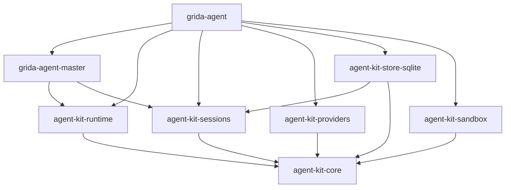
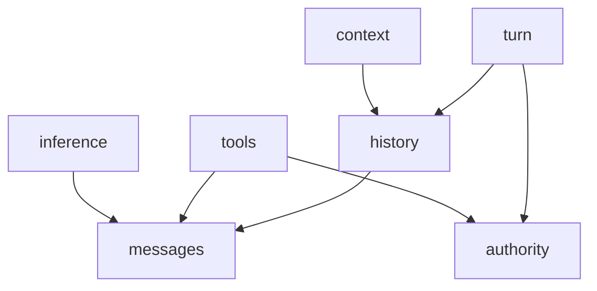

# Rust agent core proposal

This is a proposed crate layout and public Rust contract for a fresh agent
implementation. It binds the responsibilities in the [component
specification](https://grida.co/docs/wg/ai/agent/components) to concrete Rust
boundaries. The [master specification](https://grida.co/docs/wg/ai/agent/master)
owns product strategy and the [experience
specification](https://grida.co/docs/wg/ai/agent/experience) owns user-visible
promises.

The signatures below describe the candidate public surface. Supporting record
fields and error variants are summarized beside them. They are declaration
sketches, with method bodies deliberately omitted. The scope of this artifact
is documentation and API design.

## Packaging decision and growth reservations

Reserve **three coarse neutral boundaries** now: shared core, live Runtime,
and durable Sessions. Create each Cargo package when substantive work reaches
that boundary. The known durable-service and external-agent consumers justify
this destination before the first implementation grows around them.

A single-core bootstrap remains useful for an embedded-turn prototype. For the
durable vertical slice described in this proposal, the Runtime and Sessions
packages can be active from its first implementation. The lower components
remain modules of the shared core.

A reservation records a name, owned responsibility, allowed dependencies,
consumer, advantage, and activation point. It is documented design intent.
Empty Cargo packages provide no useful enforcement before implementation.

A crate boundary determines dependencies, compilation, publication, and version
compatibility. A module boundary organizes responsibility and controls access
to implementation details. Independent APIs need suitable entry points.
Packaging decisions also consider the concrete growth paths already identified.
[Rust visibility and privacy](https://doc.rust-lang.org/reference/visibility-and-privacy.html).

| Layout                           | Advantage                                                                    | Limitation                                                                               | Decision                                                              |
| -------------------------------- | ---------------------------------------------------------------------------- | ---------------------------------------------------------------------------------------- | --------------------------------------------------------------------- |
| Single core bootstrap            | Smallest initial package surface                                             | Can accumulate coupling that obstructs the already-known service boundaries              | Suitable for an embedded-only prototype                               |
| Shared core + Runtime + Sessions | Separates direct model/tool use, live turns, and durable independent drivers | Requires deliberate shared contract ownership and a few package interfaces               | Reserved destination, activated with the corresponding implementation |
| One crate per logical component  | Fine dependency and release isolation                                        | Public bridge types and package coordination before those fine divisions have a consumer | Reserve module boundaries, not all these packages                     |

### Reserved crate map

| Reserved crate                             | Owns                                                                                              | Allowed dependency direction                                             | Known consumer and advantage                                                                           | Activate when                                                                 |
| ------------------------------------------ | ------------------------------------------------------------------------------------------------- | ------------------------------------------------------------------------ | ------------------------------------------------------------------------------------------------------ | ----------------------------------------------------------------------------- |
| `agent-kit-core`                           | Messages, Inference/Tool contracts, History, Context, authority references, and journal contracts | Shared libraries for values, serialization, futures, and cancellation    | Direct inference/tool callers and every higher layer share one vocabulary                              | First component implementation                                                |
| `agent-kit-runtime`                        | Live turn cycle, admission, concurrent operations, waits, and settlement mechanics                | Core and execution utilities                                             | Embedded masters execute turns without adopting a durable service                                      | First live-turn implementation, or extraction from a short embedded prototype |
| `agent-kit-sessions`                       | Durable input acceptance, queue/control state, ownership, recovery, injected drivers              | Core and service utilities                                               | Native and external-agent drivers share durable coordination without a Runtime dependency              | First durable service implementation                                          |
| `agent-kit-sandbox`                        | Platform confinement for raw process execution                                                    | Core authority contracts and OS-specific dependencies                    | Local commands and external agents need enforceable filesystem/network/process limits                  | First raw-process execution adapter                                           |
| `agent-kit-providers`                      | Selected concrete model protocol/transport adapters                                               | Core and their selected transport/authentication dependencies            | Multiple hosts can reuse provider implementations independently of an agent loop                       | First selected provider integration                                           |
| `agent-kit-store-sqlite`                   | One SQLite implementation of SessionStore and TurnJournal                                         | Core, Sessions, and SQLite dependencies                                  | Durable execution retains one transactional authority without putting a database in the neutral kernel | First SQLite-backed durable slice                                             |
| Protocol adapter extraction, name deferred | A reusable binding for a selected external protocol                                               | The public contracts needed by that protocol                             | Independently maintained hosts can share a proven binding                                              | A second concrete consumer justifies extraction from the host                 |
| `grida-agent-master`                       | Grida policy, prompts, context selection, and product decisions                                   | Runtime, Sessions, and shared contracts through supplied capabilities    | Desktop and unattended runs use the same product harness                                               | First Grida consumer                                                          |
| `grida-agent`                              | Native executable, server protocol, and concrete host composition                                 | Master, selected neutral packages, providers, storage, and host adapters | Desktop, scripts, and process-level tests use one executable                                           | First durable headless vertical slice                                         |

The Runtime/Sessions division has especially strong evidence. Zed hosts both
native and external agents through a connection contract, and Grida already has
an external-agent route whose engine owns its loop. Direct model callers and
provider adapters also establish a credible shared-core consumer independent
of either service. [Zed agent connection](https://github.com/zed-industries/zed/blob/main/crates/acp_thread/src/connection.rs),
[Grida agent integration](../README.md#agent-provider-class-experimental--issue-813).

### Lower components stay modules

| Component           | Reserved home           | Reason to keep this granularity                                                                       |
| ------------------- | ----------------------- | ----------------------------------------------------------------------------------------------------- |
| Messages            | Core `messages` module  | Shared values participate in the same compatibility contract as their consumers                       |
| Inference contracts | Core `inference` module | Independent calls are available without an execution loop                                             |
| Tools               | Core `tools` module     | Definitions and invocation contracts introduce no concrete environment                                |
| History             | Core `history` module   | Pure records and projections share the message vocabulary                                             |
| Context             | Core `context` module   | Pure assembly can remain independently testable inside the shared library                             |
| Turn records        | Core `turn` module      | Runtime, Sessions, storage, and drivers need a common lower contract                                  |
| Authority           | Core `authority` module | Shared action identities, grant references, and validation outcomes used by Runtime and host adapters |

A future pure-data or inference-only consumer may justify a narrower package.
Those possibilities receive dependency budgets now, rather than empty crates
or a commitment to split every module.

## Proposed layout

The neutral namespace remains `agent-kit-*`. `agent-kit-core` contains the
shared modules, while `agent-kit-runtime` and `agent-kit-sessions` are reserved
higher packages. The shorter `agent-kit` name is already registered.
[Existing agent-kit package](https://crates.io/crates/agent-kit).

```text
crates/
  agent-kit-core/
    src/
      lib.rs
      messages.rs
      inference.rs
      tools.rs
      history.rs
      context.rs
      turn.rs
      authority.rs

  agent-kit-runtime/              activate with live execution
    src/lib.rs

  agent-kit-sessions/             activate with durable service
    src/lib.rs

  agent-kit-providers/            selected integrations may share one crate
    src/
      lib.rs
      openai.rs
      anthropic.rs

  agent-kit-sandbox/              activate with raw-process execution
    src/lib.rs

  agent-kit-store-sqlite/         activate with SQLite persistence
    src/lib.rs

  grida-agent-master/             activate with product policy
    src/lib.rs

  grida-agent/                    native host and executable
    src/
      lib.rs                     production host construction
      main.rs                    argument dispatch and process lifecycle
      server.rs                  local service and transport lifecycle
      acp.rs                     ACP binding and negotiated product extensions
      run.rs                     bounded non-interactive execution
      config.rs                  typed configuration storage and host operations
      hooks.rs                   configured lifecycle dispatcher and result policy
      authorization.rs           approval routing, reviewer adapters, and grant selection
      tool_host.rs               product capability dispatch and result delivery
      mcp.rs                     public MCP binding of reviewed Grida capabilities
```

This is the reserved topology. The implementation creates packages only when
it fills their stated responsibility. An embedded prototype may initially host
Runtime as a module, while keeping its intended boundary intact. Public import
paths remain provisional until that initial packaging is selected.
Such a combined bootstrap stays unpublished or explicitly provisional. Activating
the Runtime package requires a source/import move, with the dependency direction
preserved during that move.

Concrete tools can begin with their host. A reusable filesystem adapter gains
its own package when shared host consumers or platform dependencies justify it.
Provider definitions can share a package when their transport, dependency, and
release requirements align. Traits supply extension contracts independently of
crate count or dynamic plugin loading.

## Dependency budgets and graphs

At the reserved Cargo level, arrows point from a consumer to its dependency.
The implementation activates the applicable subset of this graph.



Inside the shared core, retain these logical import directions.



| Boundary          | Dependency budget                                                      | Keep outside it                                                                       |
| ----------------- | ---------------------------------------------------------------------- | ------------------------------------------------------------------------------------- |
| Shared core       | Values, serialization, futures/cancellation contracts, pure transforms | Concrete HTTP, SQLite, keyring, filesystem, UI, and Grida policy                      |
| Pure core modules | Explicit input data and deterministic computation                      | Runtime handles, clocks, network calls, and service state                             |
| Runtime           | Shared core, execution coordination, timing and concurrency utilities  | Sessions implementation, concrete providers, databases, and product decisions         |
| Sessions          | Shared core, injected driver/store contracts, service coordination     | Runtime implementation, model requests, and tool arguments                            |
| Provider adapters | Shared core and selected transport/authentication dependencies         | Product model defaults, task strategy, and session scheduling                         |
| SQLite adapter    | Shared core, Sessions, and database dependencies                       | Model execution, tool execution, and product policy                                   |
| Product master    | Runtime, Sessions, and supplied capability contracts                   | Concrete server startup, databases, provider construction, process and terminal state |
| Native host       | Master, selected adapters, transport and process utilities             | A second task loop or separate unattended agent policy implementation                 |

Cargo enforces boundaries between active packages. An initial combined package
must preserve the same import direction and private ownership by review and
boundary checks. A convenient `pub(crate)` helper must not become a hidden API
between groups reserved for separate crates. Each such interaction needs a
named capability or shared core contract.

Host composition owns the native driver adapter that implements the Sessions
contract using Runtime. This preserves their sibling relationship. The Runtime
package depends on shared Core rather than on the service that drives it.

The shared core stays below Runtime and Sessions. It cannot later become a
facade that imports those packages while they still depend on it. Any future
compatibility facade would sit above them. Persisted schema identity is
independent of Rust module paths, and public type moves require an explicit
compatibility review.

Inference receives a model-facing `ToolOffer`. Tools owns the executable
`ToolDefinition`. Runtime projects a captured definition into an offer and
retains their common identity and schema fingerprint. A direct Inference caller
needs no executor or session instance.

### Activating later boundaries

A known consumer can activate a reserved crate as soon as its substantive work
starts. Waiting for tangled dependencies or measured damage is unnecessary.
The implementation still has to satisfy the reservation's contract.

Further splits inside the shared core need a concrete additional reason.

- A supported platform or target needs a smaller dependency set.
- A separately maintained consumer needs an independent compatibility contract.
- A substantial dependency cannot stay in an integration adapter.
- Build measurements justify a smaller compilation unit.
- Repeated boundary violations justify Cargo enforcement at finer granularity.

Core consumers build its common dependency set. Finer crates can improve
exclusion or incremental builds, but that benefit has not been measured here.
The initial dependency budget therefore preserves the option of a pure-data or
inference-only extraction without claiming either is already required.

Cargo features can select optional integrations. A feature for every logical
module would add combinations without a corresponding consumer requirement.
[Cargo features](https://doc.rust-lang.org/cargo/reference/features.html).

## Rust conventions

Pure data and logic use concrete structs, enums, and functions. Dynamic dispatch
is reserved for heterogeneous providers, tool executors, durable drivers, and
storage adapters. Those traits return boxed `Send` futures. This keeps them
usable behind `Arc<dyn Trait>` under Rust's dyn-compatibility rules.
[Rust Reference](https://doc.rust-lang.org/reference/items/traits.html#dyn-compatibility)

```rust
pub type BoxFuture<'a, T> =
    Pin<Box<dyn Future<Output = T> + Send + 'a>>;
```

The asynchronous modules share the equivalent alias from `futures`. Native composition uses Tokio. Public execution
contracts expose futures and streams, while cancellation uses
`tokio_util::sync::CancellationToken`. This token signals a request. Settlement
is a separate result. Messages, History, and Context expose pure operations that need no running
executor. Their consumers still build the shared crate dependency set. [CancellationToken](https://docs.rs/tokio-util/latest/tokio_util/sync/struct.CancellationToken.html)

Validated identifiers are distinct newtypes. Invalid or oversized wire values
fail at construction. Private fields protect prepared requests, captured
inventories, and bound execution handles. Durable encodings have explicit schema
identity and version. Rust struct layout and `Debug` output carry no persistence
contract.

Operational results distinguish invalid input, unsupported capability, denied
authority, stale state, interruption, unknown external outcome, and storage
failure. Ordinary model/tool failure and requested stop remain outcome data so
the master can account for them and finish. `RuntimeError` identifies failures
that prevent trustworthy continuation, such as unavailable storage or invalid
execution state. Display text is separate from these classifications.

## Messages

`agent_kit_core::messages` owns content that can be retained, supplied to a model,
or projected to a client. Sessions owns queue state, the master selects models,
and execution accounting belongs to the turn. Storage connections stay in
adapters.

```rust
pub struct Message {
    pub id: MessageId,
    pub role: Role,
    pub phase: Option<MessagePhase>,
    pub content: Vec<Content>,
    pub provenance: Provenance,
}

pub enum MessagePhase {
    Progress,
    Answer,
}

pub enum Content {
    Text(Arc<str>),
    Reasoning(Arc<str>),
    Media(MediaRef),
    ToolCall(ToolCall),
    ToolResult(ToolResult),
    ProviderState(ProviderState),
}

pub struct ToolCall {
    pub id: ToolCallId,
    pub name: ToolName,
    pub input: ToolArguments,
}

pub enum ToolArguments {
    Json(serde_json::Value),
    Text(Arc<str>),
}
```

`ToolResult` carries the original call identity, a bounded content view, and
artifact references. The execution ledger retains the authoritative outcome.
`MediaRef` carries content identity, media type, a locator, and its declared
lifetime and access scope. A resolver supplied by the host retrieves its bytes.
Resolution returns current availability tied to that content identity. A
retained path or descriptor alone is insufficient evidence that its bytes are
still retrievable.

`ProviderState` is a narrow opaque content envelope with producer identity,
format version, validity binding, and bytes. Provider adapters interpret it.
History can retain native compaction and continuation material without importing
Inference. Its binding contains lower-level identifiers and fingerprints,
including no request or turn types from higher modules. Provider request options
remain in Inference and its adapters.

`Provenance` distinguishes supplied content, observations, generated content,
transformations, and synthetic structural repair. Repairing a missing tool result
for a model request preserves the original execution uncertainty.

Readable reasoning has its own content kind. Signed, redacted, or encrypted
provider material retains its original envelope in `ProviderState`. An optional
assistant phase is an adapter-supplied semantic hint, and never establishes
terminal settlement. This preserves the distinctions exposed by
[Codex response items](https://github.com/openai/codex/blob/6107b9886c114702e5c1cfd1c1b54f7c48bfaf49/codex-rs/protocol/src/models.rs)
and [Zed message content](https://github.com/zed-industries/zed/blob/62682ebde9e70b8a77a95863a2b16e9d59bf65eb/crates/language_model_core/src/request.rs).

## Inference

`agent_kit_core::inference` executes one model request. Its model capability data
describes supported operations and limits. The master selects the model,
instructions, tool offers, model reasoning effort, fallback, and compaction strategy.

```rust
pub trait Provider: Send + Sync {
    fn capabilities(&self, model: &ModelId)
        -> Result<ModelCapabilities, CapabilityError>;

    fn prepare(&self, request: InferenceRequest)
        -> Result<PreparedRequest, PrepareError>;

    fn start(
        &self,
        request: PreparedRequest,
        control: InferenceControl,
    ) -> Result<InferenceRun, StartError>;
}

impl InferenceRun {
    pub fn from_stream(
        stream: BoxStream<'static, ProviderEvent>,
        control: InferenceControl,
    ) -> Self;

    pub async fn next(&mut self) -> Option<InferenceUpdate>;
    pub async fn finish(self) -> InferenceOutcome;
}
```

`prepare` performs capability and structural validation without dispatching a
request. `start` constructs an owned, poll-driven operation. A `StartError`
means dispatch has not begun. Once dispatch can have occurred, failures are
reported in `InferenceOutcome` with their evidence.

The adapter-facing module exposes
`PreparedRequest::from_validated(request, binding, extension)` for trusted
provider implementations after common and provider-specific validation.
`InferenceRun::from_stream` wraps adapter events with the shared terminal and
EOF checks. Adapter implementations therefore construct these values through
public factories while ordinary callers receive immutable prepared values.
Dispatch rechecks revocable access and the prepared principal binding.
The host authority binding also covers applicable endpoint, tenant, purpose,
and credential generation. The core retains an opaque binding identity and
validates compatibility through the host. Grida organization and billing
policy stay in the concrete host adapter.

| Value              | Required contents                                                                                                                                    |
| ------------------ | ---------------------------------------------------------------------------------------------------------------------------------------------------- |
| `InferenceRequest` | Chosen model, exact messages, tool offers, output requirements, selected settings, input provenance                                                  |
| `PreparedRequest`  | Immutable validated request, capability revision, request fingerprint, provider and principal binding                                                |
| `ToolOffer`        | Tool identity/version, model-visible name and description, input form/schema, streaming-input support                                                |
| `InferenceControl` | Cancellation token, attempt deadline, input/output bounds                                                                                            |
| `InferenceUpdate`  | Text/content deltas, tool-input deltas, usage evidence, replacement-context updates                                                                  |
| `InferenceOutcome` | Completion/limit/refusal/interruption classification, failure facts and retry advice, complete/partial items, usage, continuation, and known receipt |

Successful transport completion, a complete model answer, output-limit truncation,
refusal, and an interrupted stream have distinct classifications. Failure facts
identify authentication/configuration problems, quota exhaustion, context limits,
rate limiting, transient availability, and invalid protocol data, with provider
code and retry-delay advice when available. They describe evidence, while the
master decides whether and when another attempt is justified.

Retry count, total retry time, and fallback selection are bounded master policy.
Runtime records attempts and cancelable backoff under the same turn and allowance.
A rejected credential or exhausted quota cannot become an endless transient
retry. Host-approved credential renewal keeps its principal binding. Hidden SDK
retries must be disabled or bounded and observable as separate physical attempts.

Output items preserve semantic kind so a client adapter can apply the master's
visibility policy before public serialization. Provider reasoning or continuation
material remains distinguishable from the public answer.

Usage observations identify the attempt, measurement source, category, unit,
and revision. Adapters normalize reports to cumulative quantities for an attempt.
A later revision replaces the earlier observation for that measurement, including
the terminal report. Replay preserves observation identity. Estimated, measured,
provisional, final, and unknown values stay distinguishable. Retries have separate
attempt identities. Host adapters supply pricing and authoritative charge records.

`finish` consumes any remaining updates and validates terminal evidence. An
unexpected EOF becomes an interrupted outcome. Calling `next` until exhaustion
still requires inspecting `finish` for the authoritative result. Dropping the
run abandons polling and signals cancellation to its owned work. It cannot
guarantee remote cancellation or durable settlement. Each run derives its own
child cancellation scope from the caller's token. Dropping that run only
cancels its child scope, while caller cancellation reaches all derived work.

Provider-specific settings have named adapter types that lower into a validated,
versioned request extension. Unsupported extension schemas fail explicitly.
Extensions cannot change the prepared model, authority, tool inventory, or
generic output limits through hidden fields.

Native compaction is a declared request operation or a declared response
capability. Its outcome includes replacement content, covered history, validity
binding, and usage. Continuation is reused only when the adapter validates the
current principal, request shape, history, and capabilities against that binding.

Typed image, video, audio, and 3D generation clients are adapted as Tools.
Conversational Inference remains the request/response interface used by the
agent's model loop.

## Tools

`agent_kit_core::tools` owns definitions and invocation mechanics. Concrete tools
receive their environment capabilities at construction. For example,
`FileReadTool::new(Arc<dyn Files>)` belongs in the selected filesystem adapter. A pure text
tool needs only its input values.

```rust
pub trait Tool: Send + Sync {
    fn definition(&self) -> &ToolDefinition;

    fn invoke(
        &self,
        invocation: Invocation,
        context: InvocationContext,
    ) -> BoxFuture<'_, ToolOutcome>;

    fn recover(
        &self,
        recovery: InvocationRecovery,
        context: InvocationContext,
    ) -> BoxFuture<'_, ToolOutcome>;
}

impl Inventory {
    pub fn new() -> Self;
    pub fn insert(&mut self, tool: Arc<dyn Tool>) -> Result<(), InventoryError>;
    pub fn snapshot(&self, selected: &[ToolId])
        -> Result<InventorySnapshot, InventoryError>;
}

```

`ToolDefinition` contains identity/version, model-facing description and input
contract, required capabilities, output bounds, and recovery
classification. Domain preconditions and failures belong to the tool's schema. An inventory snapshot fixes the selected executable
definitions. Current authority can still be revoked after selection.

`Invocation` contains a local invocation identity, the selected definition
identity, and input. Runtime records its mapping to turn/effect/attempt IDs.
Direct callers need no session identity.

`InvocationRecovery` contains captured input, any stored adapter checkpoint,
and known receipts. Missing input remains explicitly identified. The default recovery method reports
an unresolved outcome. Receipt-based or checkpoint-based adapters implement it.
For a tool that declares safe repeatability, the master can authorize another
attempt through the ordinary invocation path. Recovering accepted work uses its original identity and
authority binding, independently of whether new work is still offered by the
current catalogue.

`InvocationContext` contains cancellation, deadline, and bounded progress output.
Environment capabilities live in concrete tool constructors. Advanced executors
can receive a narrowly scoped stage-recording capability when their concrete
recovery contract requires one.

An unavailable tool or malformed model arguments fail before execution and produce
a bounded, correlated error result when the call has a valid identity. The model
can correct a subsequent call within the same task limits. The rejected call and
its failure remain recorded. Protocol corruption that prevents safe correlation,
storage failure, and host invariant violations remain execution failures.
Permission denial retains its distinct meaning and cannot be disguised as an
argument error to encourage circumvention.

Each invocation owns a child cancellation scope. The caller's token can stop
that scope, while cancelling one invocation leaves sibling scopes intact.

Runtime journals an ordinary invocation before calling the executor and records
its returned outcome. A tool that performs one complete operation uses that
boundary directly. Pure transformations and auxiliary presentation requests
need no invented sub-effects.

The shared Tool contract accepts complete validated arguments. Streaming edits
and multi-stage paid jobs belong to concrete executors. They define their own
stage identities, partial-result behavior, and supported recovery. The journal
can retain their opaque checkpoints and evidence without interpreting those
protocols. A paid-media adapter that accepts a remote job must retain its receipt
before depending on later status or retrieval, according to that adapter's
contract. Missing readback support leaves an outcome uncertain.

A shared incremental-input or staged-effect API requires independent consumer
evidence. The initial core adds no universal segment protocol or effect-gate
hierarchy.

`ToolOutcome` retains structured output alongside its bounded model-facing
content. Effect completion, artifact retention, and presentation delivery have
separate dispositions. Generation can succeed while an artifact remains
temporary or its optional save fails. A presentation tool can acknowledge an
emitted request without claiming that a renderer displayed it. The master uses
the relevant evidence to judge task completion.

A host adapter routes a call to the selected executor and preserves that
endpoint's identity for response correlation. Switching tabs cannot redirect an
admitted call to another endpoint. Document identity, revisions, edits, and any
conflict behavior follow the concrete tool's schema and implementation. The
journal retains invocation arguments and reported effects. If an editor endpoint
disappears, the adapter reports its unavailability or an uncertain outstanding
outcome, according to the available evidence.

### Tool hosts across process and language boundaries

A Rust `Tool` can proxy an operation performed by Electron, another binary, or
a remote service. The [concrete tool-host contract](./tool-host-contract.md)
defines Rust/Electron ownership, discovery, invocation, endpoint generations,
cancellation, and native/MCP bindings.

The Grida master chooses capabilities and judges results. The concrete Rust
host owns shared definitions, authorization, routing, and result delivery.
Electron main validates editor registration and routes to the owning controller.
Each document implementation owns its representation, edit semantics, and state.
Headless backends implement their supported document/media capabilities.

The same dispatcher serves native Tool calls and public MCP calls. The latter
can run without a Grida agent session. The neutral core remains independent of
Electron, MCP, and the product's capability schemas. A lost editor reply retains
its original target and an uncertain outcome until supported reconciliation.

## Files, workspace bindings, and scratch

Filesystem access is a host capability used by concrete tools. A demand-driven
`Files` contract serves authored project directories and separately scoped scratch
storage. The host's filesystem adapter owns these concrete records and operations.
The seven component boundaries remain sufficient.

| Host record             | Minimum contract                                                                                                             |
| ----------------------- | ---------------------------------------------------------------------------------------------------------------------------- |
| `WorkspaceSnapshot`     | Stable workspace ID, revision, named directory bindings, and an optional primary-directory ID belonging to the set.          |
| Directory binding       | Stable logical ID, resolved location or handle, binding generation, and independently supplied read/write authority.         |
| `ScratchScope`          | Owner identity, restricted file capability, storage bounds, retention policy, and active dependency holds.                   |
| Materialization receipt | Input asset identity/version, byte-equivalent source or declared transform, working-copy identity, and current availability. |
| Publication receipt     | Source result, destination identity, and the publication tool's reported result or retained reference.                       |

The product may call its saved grouping a Project. The runtime receives a
resolved workspace view and capabilities through the host bindings. An empty
directory set supports attachment-only work. Relative paths use an explicitly
selected root or its captured primary default. Directory membership does not
grant filesystem authority.

Prepared operations use the resolved workspace and directory binding. Switching
the primary directory affects later resolution. The host and executor check
authority for each selected root. Concrete file and document tools own their
content validation and edit semantics.

Messages retain `MediaRef` or native content representations. A file-oriented
tool can request materialization into `ScratchScope`; an inference-only caller
can use the supplied content directly. Input asset, mutable working copy, and
produced result retain separate identities linked by provenance. Limits apply
before publishing staged files, and retries recover the same materialization.

Scratch can be retained across suspension and restart when the host promises
that recovery. Cleanup respects active dependency holds or a validated
rematerialization path. Published results can be copied, moved, or retained
through an artifact reference. Publication uses the destination's grant and the
concrete publication tool's write semantics. Scratch writes retain validation
and confinement.

Directory enumeration is bounded and can be incremental. An eager filesystem
hydration pass or complete workspace index is not a prerequisite for a valid
read or write. Optional indexes report coverage and freshness, while direct
operations validate the actual resource.

These contracts use file tools, resource bindings, and artifact
retention. They do not require a global Project service inside the neutral core.

## History

`agent_kit_core::history` is an in-memory ordered semantic history with pure
projections. Persistence adapters encode its records through the Turn journal.

```rust
impl History {
    pub fn new() -> Self;

    pub fn append(
        &mut self,
        expected: HistoryPosition,
        records: &[HistoryRecord],
    ) -> Result<HistoryPosition, AppendError>;

    pub fn view(&self, selection: HistorySelection)
        -> Result<HistoryView<'_>, ViewError>;

    pub fn fork(&self, at: HistoryPosition) -> Result<History, ForkError>;

    pub fn project(&self, projection: &HistoryProjection)
        -> Result<ConversationView, ProjectionError>;
}
```

`HistoryRecord` represents accepted content, completed content, invocation
results, and explicit history operations. Compaction records include covered
positions, replacement content, retained references, and provenance. Rewind and
fork modify lineage and projections. The execution ledger continues to retain
external-effect receipts.

Appending validates the entire batch before changing the in-memory history.
Any invalid position or record rejects the whole append. A compaction result is
a candidate until its covered range, lineage, provider binding, and resulting
context are validated. Install it atomically against that basis, preserving
accepted input and completed outcomes outside the range. Failure, cancellation,
or a stale basis leaves the active projection intact. A partial tool exchange
cannot be silently cut away or converted into a completed operation.

There is one source position for each retained semantic record. An observer
cursor and a session control revision are separate types. External document
versions, when a tool uses them, remain part of that tool's domain data.

## Context

`agent_kit_core::context` assembles selected history and supplied fragments into a
bounded, structurally valid model input.

```rust
pub fn assemble(
    input: ContextInput<'_>,
    limits: ContextLimits,
    transform: ContextTransform,
    measure: &dyn ContextMeasure,
) -> Result<ContextSnapshot, ContextError>;

pub trait ContextMeasure {
    fn measure(&self, content: &[Message]) -> ContextMeasurement;
}
```

`ContextInput` includes explicit history selections, supplied fragments, and an
explicit non-message input-overhead measurement. That measurement covers the
captured tool declarations and provider framing, with its inventory fingerprint,
provider/model representation revision, and exact/upper-bound/estimated status.
`ContextMeasure` measures the candidate messages, including their media costs.
Assembly accounts for each contribution once. Component counts remain estimates
unless the adapter establishes a conservative combined bound, since tokenizer
and serialization boundaries can change the total. Validation of the complete
provider representation is authoritative. Output-token headroom is reserved
separately from input occupancy. This preserves Context's data-only dependency.
The provider's final preparation validates the overhead binding and checks the
complete encoded request against the applicable limits. Unknown encoding costs
remain estimated and cannot certify a hard ceiling.

`ContextTransform` selects concrete operations such as preserving content,
trimming complete exchanges, or applying supplied replacement content. The
master supplies their order and parameters.

`ContextSnapshot` contains the exact messages, source positions, provenance map,
and measured or estimated occupancy. `ContextMeasure` is local and deterministic
for its declared tokenizer/version. Remote counting uses an admitted provider
operation, while summarization uses Inference. Both supply results as data.
Retrieval runs through Tools.

Provider counting has its own precision contract. Responses exposes an exact
input-count endpoint that includes request framing, instructions and tools.
Claude describes its count as an estimate. Remote counting uses the selected
authority and can transmit prepared content before generation. Its result
stays bound to that exact request, with cancellation and a shared deadline.
[Responses token counting](https://developers.openai.com/api/docs/guides/token-counting),
[Claude token counting](https://platform.claude.com/docs/en/build-with-claude/token-counting).

The captured snapshot also preserves instruction and skill content identities,
scope, trust, and source versions. Recovery uses the recorded request material.
A policy-selected refresh applies to a subsequent prepared decision and records
its changed inputs. Required-source failure is an explicit master decision.
This reuses Context and ordinary retrieval operations.

Provider structural constraints enter as explicit data. Provider-owned content
retains its identity and binding through assembly. Context cannot infer that
cached content costs zero context space or that a synthetic repair proves an
external action failed.

### Derived conversation initialization

A derived conversation uses an authorized history seed with source identity,
committed position, selected material or retained references, and transformation
provenance. The seed can preserve full selected history. Context assembly later
produces a bounded `ContextSnapshot` for the chosen model. The host initializes
a new journal or session from the retained seed. Source lineage and execution
ownership are separate bindings.

| Construction input      | Existing component or host responsibility                                                                                                               |
| ----------------------- | ------------------------------------------------------------------------------------------------------------------------------------------------------- |
| Source material         | History selects a coherent retained snapshot. Any compaction or normalization is explicit, and model context is assembled separately.                   |
| Instructions and role   | The master supplies the new purpose and marks inherited material as reference context.                                                                  |
| Model and tools         | Inference validates the selected model and provider binding. The master selects the tool inventory.                                                     |
| Authority               | The host resolves grants independently for the new conversation. Tools and the native executor enforce them.                                            |
| Retention               | Select transcript retention and execution-journal durability independently. Temporary transcripts can use a persistent journal for recoverable effects. |
| Ownership and allowance | The host declares control relationships and funding. Context lineage creates neither automatically.                                                     |
| Result delivery         | The master explicitly forwards selected results through ordinary correlated input when requested.                                                       |

Read-only and action-capable instances are compositions of these inputs. The
neutral components have no `SideChatMode` flag. `CreateSession` can carry the
resolved context seed when persistent storage is selected, while an ephemeral
caller supplies it to the in-memory journal. Driver state, active goals, queued
work, waits, and delegation authority are initialized explicitly instead of
being copied implicitly with the context.

Inherited pending tool calls remain historical evidence. Normalization preserves
their unresolved status and never schedules them in the new conversation.
Provider-owned continuation material is copied only when compatible with the
new binding. Later parent activity requires an explicit refresh from a new
source position.

The transcript's short lifetime does not shorten required effect retention.
An action-capable temporary conversation retains the operation inputs and
receipts required by its declared recovery contract. A strict discard policy
must select capabilities whose lifetime and recovery requirements it can satisfy.
Parent and derived conversations invoke document tools under those tools'
own operation contracts.

A hard context limit requires an exact count or a valid upper bound. If only
an estimate is available, assembly reports that limitation and the master can
choose an explicitly estimated policy or obtain stronger measurement.

## Turn records and journal

`agent_kit_core::turn` owns the durable vocabulary for one execution. It contains
turn/effect/attempt IDs, phase and outcome records, conditional positions,
checkpoint envelopes, journal interfaces, and settlement receipts. It performs
no inference, tool dispatch, queue selection, or process spawning.

```rust
pub struct TurnLease {
    // Private fields. Intentionally not Clone.
}

impl TurnLease {
    pub fn journal(&self) -> &dyn TurnJournal;
    pub fn controls(&self) -> &dyn ControlReader;
}

pub fn bind_lease(
    binding: TurnBinding,
    journal: Box<dyn TurnJournal>,
    controls: Arc<dyn ControlReader>,
) -> Result<TurnLease, BindingError>;

pub trait TurnJournal: Send + Sync {
    fn load(&self) -> BoxFuture<'_, Result<TurnSnapshot, JournalError>>;

    fn commit(&self, change: JournalChange)
        -> BoxFuture<'_, Result<CommitReceipt, JournalError>>;

    fn lookup(&self, change: ChangeId)
        -> BoxFuture<'_, Result<Option<CommitReceipt>, JournalError>>;
}

pub trait ControlReader: Send + Sync {
    fn read(&self)
        -> BoxFuture<'_, Result<ControlSnapshot, ControlError>>;

    fn changed(&self, after: ControlRevision)
        -> BoxFuture<'_, Result<ControlSnapshot, ControlError>>;
}

pub enum CommitReceipt {
    Recorded(RecordedPosition),
    Suspended(SuspensionReceipt),
    Settled(SettlementReceipt),
}
```

`TurnLease` transfers unique continuation ownership into Runtime. It contains a
bound `Box<dyn TurnJournal>` and the authoritative control reader for the same
turn and writer epoch. Trusted storage implementations construct it after
acquiring ownership. Runtime consumes the lease once and shares the journal
internally with scoped operations. A second controller requires an explicit
recovery claim under a new epoch.

Runtime and external drivers use the lease's bound journal and control-reader
interfaces. They retain the lease itself as their ownership guard, while its
storage fields remain private to the shared core.

`bind_lease` lives in the adapter-facing module. It checks that the journal and
control reader match the binding. Storage enforces exclusive issuance and
epoch validity. Runtime keeps the consumed lease alive alongside its internal
operation handles. Journal adapters also have a
public factory for receipt references. Verification against the store establishes
their authority.

`ControlReader` is a read-only storage port for committed controls. Its
notifications can be delayed or coalesced. Every admission still checks its
control preconditions in the journal transaction.

`JournalChange` contains a stable `ChangeId`, content digest, expected execution
and history positions, applicable control preconditions, execution records,
related History records, and an optional master checkpoint. A terminal change
also contains the proposed outcome and any consumer-authored final account. One commit publishes the
related facts atomically. Repeating the same change ID and content returns its
recorded receipt. Different content under that ID is rejected before revision
checks.

Journal errors distinguish a confirmed rejection from an unknown commit
acknowledgment. A cancelled waiter can lose its response while the storage
worker completes the commit. `lookup` resolves the same change identity against
authoritative storage. Until that outcome is known, dependent execution and
settlement stay suspended. Retrying a write preserves its original identity.

| Execution fact       | Minimum retained information                                                                                                         |
| -------------------- | ------------------------------------------------------------------------------------------------------------------------------------ |
| Effect prepared      | Effect/attempt identity, input encoding or durable reference, adapter/definition version, authority scope, limits, recovery identity |
| Attempt outcome      | Classification, receipt, usage, artifact references, partial effects, remaining uncertainty                                          |
| Wait opened/resolved | Wait identity, expected answer contract, accepted answer, scope, expiry/cancellation disposition                                     |
| Master checkpoint    | Stable checkpoint identity, owner schema and version, bounded encoded state, integrity digest, source positions                      |
| Settlement           | Terminal outcome, optional consumer account, effect dispositions, master-supplied evidence references, control/history dependencies  |

Admission changes validate the current control state. Outcome recording can
still incorporate evidence after cancellation, under the current writer's
authority. A stale attempt's receipt remains evidence, while its sender has no
authority to advance the turn.

`SettlementReceipt` identifies the committed terminal record and writer epoch.
Trusted journal implementations construct it. Sessions verifies it against
authoritative storage before acting on it. A returned Rust value alone cannot
establish durable completion.

`EphemeralJournal` supplies the same API over memory. Its factory returns the
unique lease and a separate ephemeral control writer for the host. The
persistent route writes controls through Sessions. Each implementation states
its failure model and commit barrier. Versioned input/checkpoint envelopes are
owned by their producing adapter or master. They contain no untyped map of
unrelated application state.

```rust
impl EphemeralJournal {
    pub fn create(seed: TurnSeed) -> EphemeralTurn;
}

pub struct EphemeralTurn {
    pub lease: TurnLease,
    pub control: EphemeralControl,
}

impl EphemeralControl {
    pub async fn resolve_wait(&self, request: ResolveWait)
        -> Result<ControlReceipt, ControlError>;

    pub async fn cancel(&self, request: CancelTurn)
        -> Result<ControlReceipt, ControlError>;
}
```

Both requests carry a stable control identity and expected control revision.
`ResolveWait` also carries the exact wait identity and typed response.

## Authority, approval, and confinement

Each admitted operation needs authority supplied by the host. The detailed
domain contract remains [Execution authority](https://grida.co/docs/wg/ai/agent/execution-authority).

| Concern                      | Owner                                 | Responsibility                                                                     |
| ---------------------------- | ------------------------------------- | ---------------------------------------------------------------------------------- |
| Authority ceiling            | Host                                  | Mandatory denials, grant issuance, delegation limits, and required enforcement.    |
| Approval and reviewer policy | Master and host authorization adapter | Review eligibility, human/model routing, evidence, escalation, and interpretation. |
| Shared authority records     | Core `authority` module               | Action/scope identity, grant references, and validation outcomes.                  |
| Admission                    | Runtime                               | Invoke the supplied gate, recheck current controls/grants, and journal dispatch.   |
| Durable interactions         | Sessions and journal                  | Retain identified requests, responses, operation results, and continuation state.  |
| Execution confinement        | Host capability and sandbox adapter   | Enforce filesystem, network, process, credential, and lifetime limits.             |

The host authorization adapter owns approval schemas and binds a decision to
the requested action, arguments, scope, and policy. Human approval and automatic
review are product routes through this adapter. The generic core retains the
request, response, and supplied evidence using ordinary interaction and operation
records. The adapter interprets them and selects or obtains the actual grant.

An asynchronous admission gate can perform a recorded check or register a
correlated interaction before returning permission, denial, or a deferred wait.
Runtime covers every tool invocation, including calls emitted inside a step.
It validates current controls and host-issued authority again before committing
dispatch. A review response alone supplies no new authority. Restored decisions
must pass the authorization adapter's current validity checks.

The master selects a reviewer and its bounded allowance. A model-based review
uses ordinary Inference and Tools with explicitly supplied authority. The host
owns its evidence policy, escalation, retry, and failure handling. These routes
need no `Human`/`Model` enum or dedicated reviewer interface in the shared core.

`agent-kit-sandbox` is a reserved native adapter boundary. Its platform backends
compile host-issued execution scope into actual confinement and report whether
the requested profile can be enforced. A raw command or external agent receives
that scope for its process tree. Required but unavailable enforcement rejects
launch. Structured editor operations use their host capability checks.

The rebuild replaces srt. The [native sandbox proposal](./rust-sandbox-proposal.md)
selects Seatbelt on macOS and bubblewrap plus a trusted seccomp helper on Linux
for the first raw-command implementation. Raw networking is denied initially.
Native Windows raw execution remains unavailable until its own backend proves
the requested profile. Host-native routing and transport trust remain host
adapter concerns.

Whole-host containment is a separate deployment profile. The current TS host's
outer sandbox is evidence for that deployment, and does not require the native
host to reproduce its process topology. The native host declares its trusted
services, raw execution boundaries, and selected hardening independently.
Concurrent raw executions retain independent filesystem, network, and
inherited-handle authority. The neutral adapter does not require a particular
host-process topology.

Cancellation records distinguish a stopped operation, terminated worker,
revoked descendant authority, and completed cleanup. A process-group signal alone
does not prove all of these. A detached descendant can remain confined while
still modifying resources inside its grant. Releasing conflicting ownership
requires verified termination or revocation of the relevant access. The executor
reports that evidence through the existing outcome and recovery contracts.

## Runtime

`agent_kit_runtime` owns live execution mechanics. The master is an ordinary
async program using a scoped turn controller. It can assemble context, run a
step, inspect the outcome, invoke verification, request an answer, and decide
when to finish.

```rust
impl Runtime {
    pub fn new(services: ExecutionServices) -> Self;

    pub async fn open(
        &self,
        lease: TurnLease,
    ) -> Result<OpenedTurn, OpenError>;
}

pub struct OpenedTurn {
    pub turn: Turn,
    pub observer: TurnObserver,
}

impl TurnObserver {
    pub fn snapshot(&self) -> TurnView;
    pub async fn next(&mut self) -> Option<TurnUpdate>;
}

impl Turn {
    pub fn view(&self) -> MasterView;
    pub fn operation(&self, key: &OperationKey) -> Option<OperationView>;
    pub fn operations(&self) -> TurnOperations;

    pub async fn checkpoint(&mut self, state: MasterCheckpoint)
        -> Result<CheckpointReceipt, RuntimeError>;

    pub async fn step(&mut self, plan: StepPlan)
        -> Result<StepOutcome, RuntimeError>;

    pub async fn try_finish(&mut self, draft: CompletionDraft)
        -> Result<FinishOutcome, RuntimeError>;

    pub async fn try_suspend(&mut self, draft: SuspensionDraft)
        -> Result<SuspendOutcome, RuntimeError>;
}

impl TurnOperations {
    pub async fn infer(&self, key: OperationKey, request: PreparedRequest)
        -> Result<InferenceOutcome, RuntimeError>;

    pub async fn invoke(&self, key: OperationKey, invocation: PlannedInvocation)
        -> Result<ToolOutcome, RuntimeError>;

    pub async fn wait(&self, request: WaitRequest)
        -> Result<WaitOutcome, RuntimeError>;

    pub async fn request_input(&self, request: WaitRequest)
        -> Result<InteractionReceipt, RuntimeError>;
}

pub enum FinishOutcome {
    Settled(SettlementReceipt),
    Continue(FinishRejection),
}

pub enum SuspendOutcome {
    Suspended(SuspensionReceipt),
    Continue(SuspendRejection),
}
```

`Turn` is the unique continuation/settlement controller. `TurnOperations` is a
cloneable capability limited to that active turn. The master can obtain it
before awaiting a step and use it for independent work concurrently. Admission
and journal publication remain serialized internally. No mutex guard spans an
external await. Beginning settlement closes all operation capabilities to new
work and accounts for already admitted operations before committing. A rejected
completion retains the controller so the master can handle new input or missing
evidence. Admission reopens only when the current control state permits it.
Successful settlement permanently closes the turn. An unconfirmed settlement
commit enters reconciliation and keeps admission closed until readback resolves
that commit's identity. Dropping the controller synchronously revokes new
admission through surviving operation handles and signals their child
cancellation scopes. In-flight guards retain ownership until local work exits.
Their durable outcomes still require explicit recording or later reconciliation.

`try_suspend` records an intentional handoff of an unfinished turn. Its draft
binds the current control/history basis and an existing checkpoint when needed.
Admission closes and local effects must be quiescent or transferred to an explicitly retained owner
before the journal commits a `SuspensionReceipt`. Rejection retains the controller.
An uncertain commit freezes admission until readback. Verified suspension makes
the old live handles inactive and preserves logical waits and operation identities.
It produces no terminal completion or final account.

`Runtime::open` receives resolved provider/executor bindings through its
construction configuration and reconstructs the journal's current state. It
reports outstanding effects for reconciliation before conflicting new work.
The non-cloneable `TurnLease` supplies the journal and authoritative control
observation and is consumed once by `open`.
Notifications improve responsiveness. Conditional journal admission enforces
the latest state.

`ExecutionServices` contains explicitly identified provider bindings, tool
inventory, the supplied admission gate, and host execution limits.
Selecting which providers or tools a step uses remains in `StepPlan`. Document
state management stays inside the concrete document tools.

`TurnObserver` exposes a current `TurnView` and bounded updates of text,
tool progress, pending waits, and terminal status. Dropping it detaches the
observer. Ephemeral hosts obtain a control handle alongside their in-memory
lease through `resolve_wait(ResolveWait)` and `cancel(CancelTurn)`.
Durable hosts use the corresponding
Sessions controls. Both routes record the exact answer or approval before
execution resumes.

`MasterView` is a designed view of accepted input, incorporated steering,
semantic history, operation results, remaining allowances, and optional master
state. Journal replay records stay behind the storage-facing interface.
Reading this view, subscribing, inspecting a session, and reconnecting a client
are observation operations. They never admit work or trigger queue advancement.

`WaitRequest` carries an identity, request payload, response schema, and the
authority needed to answer it. The requesting tool owns that schema, allowing
text answers, selected assets, and other structured results. The host authorization adapter interprets approval responses and validates
their action binding. A narrow host adapter can expose
`TurnOperations::wait` to an interactive tool while `step` awaits that tool.
That adapter is scoped to the current turn/invocation and is released with it.
Shared tool registrations never retain another turn's operation handle.
User selection supplies the chosen identities without promoting asset-supplied
titles or metadata into user instructions.

`request_input` durably registers the question and returns its stable receipt
without awaiting the answer. The question tool can complete with that receipt
while independent work continues. A later answer is a correlated control and
new history contribution, never a replacement of that tool's completed result.
`wait` combines the same registration with awaiting its response. Dropping the
waiter or suspending the turn preserves the registered question. Recovery can
reattach to that identity and complete an answer-dependent invocation.

Both styles release finished inference capacity. A master with no further work
can use `try_suspend`, allowing the worker future to end until a recorded resume
condition is satisfied. Answers racing suspension are durably retained and
checked on the next claim. An explicit user pause remains effective when an
answer arrives. Ordinary submissions cannot implicitly answer an approval.

An answer-dependent `step` can return a resumable `Pending` outcome when its
input-wait policy requests yielding or a Pause control arrives. This ends the
method's mutable borrow so the master can call `try_suspend`. The pending
outcome identifies the unfinished step, interactions, and invocations. It
preserves their durable continuation records without inventing completed tool
results. Resuming the same operation key attaches to that work and completes it
from the recorded answer. A live waiter remains an available policy choice.

`StepPlan` contains a prepared inference, captured executable inventory, tool
admission policy, input-wait policy, scheduling limits, purpose, and a stable operation key. A step consumes one inference
and executes complete validated tool calls attributed to its response.
Inference tool offers must match that captured inventory.
Runtime validates this relationship before dispatch.

This is an attribution boundary. Complete validated calls may execute while
later response items stream, and independent calls may overlap. The first tool
profile dispatches each eligible call after its arguments validate. Streaming
edit protocols remain executor-specific.
Before dispatch, Runtime records that call's identity, arguments, captured
definition, and originating inference. A later model-stream failure preserves
the real effects and results of already admitted calls. Once response-derived
effects were admitted, transport recovery cannot silently replay the original
request as if no tools ran. Reconcile outstanding work and prepare continuation
from the retained calls/results. Fresh model-generated call IDs alone do not
make equivalent repeated effects safe.

Operation keys are unique within a turn. Reusing a key with the same captured
inputs attaches to the existing operation or returns its committed outcome.
Different input under that key is rejected. A retry of an interrupted physical
attempt remains inside that operation and requires the executor's recovery
contract. A completed step returns its recorded `StepOutcome`, including tool
results. An unknown or in-flight operation first requires reconciliation. An
intentional new repetition uses a new key. `WaitRequest` likewise carries a
stable wait identity.

If the inference and individual tool outcomes are committed but the aggregate
step result is missing, Runtime reconstructs the `StepOutcome` from those
records. Rebuilding the aggregate requires no repeated inference or tool work.

`operation` exposes recorded status and typed outcomes by key. Recovery can read
an already completed operation before rebuilding its request or contacting its
provider. An unavailable provider therefore does not prevent reading a result
that was committed earlier.

The master uses `checkpoint` for product state that cannot be reconstructed
from committed history, plans, and outcomes. A simple conversational master
derives its cursor and next operation key from that record and needs no separate
workflow checkpoint. Each operation records its continuation basis. After
restart, the driver reconstructs the master from that basis and reuses the same
keys. A restored call retrieves an already committed result. Rust stack frames
and in-memory futures are reconstructed by the driver.

The checkpoint records operation keys or enough state to derive them
deterministically. Their input digest covers serialized prepared data and
captured tool/policy identities. Credentials and physical-attempt transport
nonces remain outside that encoding.

Captured plans persist provider/tool binding identities, definition versions,
resolved data, and policy identity. Recovery resolves those bindings through
`ExecutionServices`. An unavailable or incompatible binding leaves the work in
an explicit recovery state. Trait objects and closures are recreated from
those identities and the supported master checkpoint schema.

```rust
pub trait ToolGate: Send + Sync {
    fn decide(
        &self,
        call: ToolAdmission,
        context: AdmissionContext,
    ) -> BoxFuture<'_, ToolDecision>;
}

pub enum ToolDecision {
    Permit(GrantSelection),
    Deny(Denial),
    Defer(WaitId),
}
```

The supplied gate is an asynchronous admission boundary. `AdmissionContext`
provides current control/authority observations and scoped operations for
recorded checks. Those operations retain their own bounds, authorization, and
stable identities. The host implements hook dispatch and approval routing
through this boundary. It can return a correlated wait so the turn can suspend.
Runtime retains that pending invocation and re-enters the gate using recorded
state when eligible. The host reuses completed checks and interprets responses.

A permit selects existing host-issued authority. Runtime checks that authority
and current controls at dispatch. Host gate implementation details and product
policy remain outside `ExecutionServices`. Exact gate context fields require
the first approval and hook consumers to establish their minimal shared needs.

`ToolAdmission` contains the definition, supplied scope, and complete validated
arguments. The executor owns any internal staging protocol and its recovery data.

`CompletionDraft` carries the master's outcome judgment, optional final account, and
evidence dependencies. Runtime checks current controls, outstanding owned work,
and interaction dispositions. The master decides which child results or other
task evidence are required before requesting completion. Required unanswered questions
normally lead to suspension. Terminal completion or Stop must withdraw,
supersede, or explicitly transfer outstanding interactions while preserving
their records. A late answer cannot reactivate a settled turn.
Runtime then commits settlement or reports the condition that
prevents it. Reporting inference runs before `try_finish` within its reserved budget.
Stop closes new task-effect admission while the driver remains able to record
receipts and commit a factual account. A simple answer can itself be the final
account. Additional reporting inference is a master choice.
The Grida master supplies an account for every terminal turn. Other consumers
can settle with structured outcomes alone.

Scarce inference permits are released when the request finishes, before waiting
for tool or child work that needs those permits. Spending reservations remain
accounted separately. Runtime enforces supplied hard bounds. The master decides
their allocation and the value of additional work.

The master is trusted application code. Effects included in managed execution's
recovery guarantees must pass through the scoped execution operations. Rust
trait boundaries cannot prevent application code from opening an unrelated
socket or file.

### Configured lifecycle hooks

The [hook contract](https://grida.co/docs/wg/ai/agent/hooks) is implemented by the
host dispatcher using the admission gate, recorded outcome boundaries, and
ordinary scoped operations. Runtime has no configured-handler registry or
named hook-event vocabulary. The host owns discovery, matching, order, recursion
suppression, required-check semantics, and result interpretation.

The initial host supports command handlers. They execute through admitted tools
under the selected confinement profile. The host assigns stable operation keys
and records the selected handler identity with its invocation. Recovery can
reuse completed results. Interrupted commands retain the executor's ordinary
uncertainty and recovery behavior.

Pre-tool checks use the gate so calls produced inside `step` receive the same
policy as direct invocations. The host consumes recorded outcomes for after-tool
checks. The master runs input and completion checks at its decision boundaries.
A required check that affects subsequent work must complete before that work is
admitted. Ordinary event subscriptions remain observational.

Grida's initial policy runs handlers in declared order, blocks the governed
action on required-check failure, and suppresses recursive user-hook dispatch
for its own handler operations. Authority checks still apply to those operations.
Stop and Pause govern handler work through the same controls as other operations.
Executable work after settlement needs another explicitly admitted owner.

The first host fixture fixes event names, response fields, and how its dispatcher
uses the minimal gate context. Argument rewriting, background handlers, and
additional handler types remain separate product extensions.
[Codex hooks](https://github.com/openai/codex/blob/6107b9886c114702e5c1cfd1c1b54f7c48bfaf49/codex-rs/hooks/src/lib.rs),
[dispatcher](https://github.com/openai/codex/blob/6107b9886c114702e5c1cfd1c1b54f7c48bfaf49/codex-rs/hooks/src/engine/dispatcher.rs),
[command runner](https://github.com/openai/codex/blob/6107b9886c114702e5c1cfd1c1b54f7c48bfaf49/codex-rs/hooks/src/engine/command_runner.rs).

## Sessions

`agent_kit_sessions` durably accepts identified input and coordinates an
injected turn driver. Its submission body is opaque, bounded, versioned data.
The driver owns decoding it and constructing the master.

```rust
pub trait TurnDriver: Send + Sync {
    fn capabilities(&self) -> DriverCapabilities;

    fn run(&self, claim: ClaimedTurn)
        -> BoxFuture<'static, Result<DriverOutcome, DriverError>>;
}

pub enum DriverOutcome {
    Settled(SettlementReceipt),
    Suspended(SuspensionReceipt),
}

impl Sessions {
    pub fn new(
        store: Arc<dyn SessionStore>,
        driver: Arc<dyn TurnDriver>,
    ) -> Result<Self, ConfigurationError>;

    pub async fn create(&self, request: CreateSession)
        -> Result<SessionCreated, SessionError>;

    pub async fn submit(&self, session: SessionId, input: Submission)
        -> Result<Acceptance, SessionError>;

    pub async fn control(&self, request: ControlRequest)
        -> Result<ControlReceipt, SessionError>;

    pub async fn run_selected(&self, selection: TurnSelection)
        -> Result<RunDisposition, SessionError>;

    pub async fn recover(&self, request: RecoveryRequest)
        -> Result<RunDisposition, SessionError>;

    pub async fn inspect(&self, session: SessionId)
        -> Result<SessionView, SessionError>;
}

pub enum RunDisposition {
    Settled(SettlementReceipt),
    Suspended(SuspensionReceipt),
    Existing(ClaimStatus),
}
```

`create` establishes a caller-identified session with bounded, versioned driver
configuration. `submit` acknowledges durable acceptance independently of driver preparation.
Repeating an input ID with identical content returns its existing disposition.
Conflicting content under that ID fails.

### Session driver state

In addition to construction configuration, a session can retain one optional
`DriverStateSnapshot`. It is a bounded schema-versioned envelope with an
independent state revision and content digest. Its payload belongs to the driver.
Core does not interpret objective status, operating regime, or product policy.
Minimal masters may omit this state.

`CreateSession` may initialize the envelope. `ControlRequest` can carry a
conditional `DriverStateChange`, including alongside an existing pause or cancel
control. `JournalChange` can commit such a change atomically with turn progress,
suspension, or settlement. Existing request identities and digest checks cover
retries. Conflicting revisions fail explicitly, and an unknown acknowledgment
is resolved by readback before dependent work.

Committed changes return the resulting state revision and make it observable
through the control reader and session views. Progress and usage records remain
separate from this driver-state revision unless the driver deliberately commits
a corresponding state change at a decision boundary.

`CompletionDraft` and `SuspensionDraft` may include a `DriverStateChange` so the
state update shares the turn's commit. Goal tools use a narrowly granted state
control with the same conditional-update and request-identity rules. They do
not receive unrestricted access to the session store.

`ClaimedTurn` and `MasterView` provide the trusted driver with the selected
snapshot. `SessionView` exposes its revision for reconciliation, while the host
projects user-facing fields through its client adapter. Credentials remain in
their dedicated host-owned custody. A decision that depends on driver state
records its revision in `TurnSelection`, `StepPlan`, `SuspensionDraft`, or
`CompletionDraft` as appropriate. Admission verifies it before dependent work.
When no state is consulted, no extra precondition is required.

This supports a persistent-goal harness as an ordinary consumer. The master can
store an objective and progress, contribute goal tools, and select another
ordinary turn after a prior one finishes. A goal edit or pause changes the state
revision and invalidates an already prepared continuation. The same mechanism
supports other cross-turn product state without adding a `GoalMode` variant.

Cumulative allowances can be derived from recorded operation receipts and
reservations. Their scope can span turns and children. The next claim must
include earlier unsettled reservations and late usage, so settlement or session
reload cannot refund uncertain work. A goal completion transition commits with
any terminal account asserting it. Turn completion alone carries no objective
completion meaning.

### Selection and controls

`TurnSelection` has a stable `ClaimId`, expected control revision, and either
selected accepted inputs for a new turn or the identity and suspension receipt
of an existing unfinished turn. The master or host scheduler chooses it. `run_selected`
claims ownership atomically and drives a newly issued lease. The host owns the
future's task lifetime. A repeated claim returns the existing disposition and
never issues a second live lease. An unknown acknowledgment is resolved using
that same claim identity before the caller attempts recovery.
`Existing` reports an active, suspended, or interrupted claim without starting a
competing driver. `Settled` and `Suspended` are returned only after verification
against the store. A suspension retains the logical turn while releasing its
live execution lease. A conditional resumed claim uses the same `TurnId` and a
fresh writer epoch after its pause and readiness conditions permit execution.
The suspended logical turn retains its active session position. Suspension
alone never selects the next queued request.

`ControlRequest` includes a stable `ControlId`, target, content digest, and
expected control revision. Repeating identical content returns the original
receipt even after the revision has advanced. Defined
operations include steering, queue replacement/reordering, task pause/resume,
pausing/resuming admission, cancellation, resolving an identified wait,
lifecycle deletion, and atomic pause-plus-cancel. The product chooses which
operation and target scope its controls request. Display metadata such as names
and archive visibility remains host-owned and does not imply execution control.

A queue-content edit supplies a new immutable `Submission` identity that
supersedes the unclaimed input at its existing position. The old identity retains
its superseded disposition. The control transaction checks that the selected
input has not been claimed. Replacement and claim cannot both succeed against
the same state. Reordering preserves the selected input identities. `TurnSelection`
captures the actual selected inputs and any consulted driver-state revision.
The opaque payload and driver state carry settings according to master policy.

Deriving an independent conversation uses a captured history seed and leaves
the source's work and interactions intact. Copied interaction records provide
history only. Changing a conversation's active history is an explicit control
that coordinates affected work and supersedes its waits and approvals together,
while retaining their records. Restoring their visibility preserves the old
dispositions. A late answer cannot resolve a current wait or grant current authority.
Late effect results also retain their original step and branch attribution.
They cannot become new work on the selected branch merely by arriving later.

`ClaimedTurn` carries accepted input, turn identity, writer epoch, current
checkpoint, and the non-Clone `TurnLease`. The native driver transfers the lease
into Runtime and runs the product master. The Sessions module uses the Turn contract without constructing Runtime.

The adapter-facing storage contract has the following bounded operations.

```rust
pub trait SessionStore: Send + Sync {
    fn create(&self, request: CreateSession)
        -> BoxFuture<'_, Result<SessionCreated, StoreError>>;

    fn submit(&self, session: SessionId, input: Submission)
        -> BoxFuture<'_, Result<Acceptance, StoreError>>;

    fn claim(&self, selection: TurnSelection)
        -> BoxFuture<'_, Result<ClaimOutcome, StoreError>>;

    fn recover(&self, request: RecoveryRequest)
        -> BoxFuture<'_, Result<ClaimOutcome, StoreError>>;

    fn control(&self, request: ControlRequest)
        -> BoxFuture<'_, Result<ControlReceipt, StoreError>>;

    fn inspect(&self, session: SessionId)
        -> BoxFuture<'_, Result<SessionView, StoreError>>;

    fn verify_settlement(&self, receipt: SettlementReceipt)
        -> BoxFuture<'_, Result<VerifiedSettlement, StoreError>>;

    fn verify_suspension(&self, receipt: SuspensionReceipt)
        -> BoxFuture<'_, Result<VerifiedSuspension, StoreError>>;

    fn record_interruption(&self, request: DriverInterruption)
        -> BoxFuture<'_, Result<InterruptionReceipt, StoreError>>;
}
```

`ClaimOutcome` distinguishes a newly issued `ClaimedTurn`, an existing active,
suspended, or interrupted claim, and an already settled turn. Only the newly issued variant
contains a lease. `RecoveryRequest` identifies the unresolved turn, expected
old epoch, and a stable recovery request ID. It preserves the turn identity,
acquires a new epoch after ownership release is established, and reconstructs
committed work for reconciliation. Recovery does not resubmit accepted input.

Each mutation has a stable request identity and content digest. Repeating an
identical request retrieves its committed disposition. Conflicting reuse is
rejected. Store errors distinguish rejection from an unknown acknowledgment,
and inspection exposes the current disposition when a response was lost.

On a driver error, Sessions first reads authoritative state and verifies any
settlement or suspension receipt. Either committed handoff survives loss of the
driver's return value. After the local controller exits, `record_interruption`
applies only if that turn has neither settled nor committed an intentional
suspension. It preserves outstanding-effect
uncertainty. If the execution future itself is dropped, the next recovery can
establish local ownership release without relying on that asynchronous write.

`SessionView` is a designed projection of accepted input dispositions, queue
state, current activity, waits, and settled outcomes. Its authorized child view
includes retained child references, assignment status, and supported controls.
A client subscription
adds a cursor and resynchronization protocol around these views. Raw storage
rows stay behind the adapter-facing contract.

`DriverCapabilities` declares durable-acceptance coverage, controls, observation,
reconnect/restart support, and ownership of child work. For an external agent,
the outer run can durably record submission and remote receipts. The external
agent's internal effects require its own declared guarantees.

### Reusable child sessions

Child execution uses the same Sessions service through a separately granted
delegation capability supplied to concrete product tools. A child retains one
`SessionId` across assignments. Each accepted input has a stable input identity.
It can start a new `TurnId` or steer an existing one. Each execution turn records
its execution owner, authority binding, and supplied allocation. The product
chooses whether that allocation is sponsored by the parent or another source. Optional display labels are host
metadata. An addressable task alias resolves uniquely within the parent's roster
before a control reaches Sessions. Labels and aliases confer no authority.

| Product operation    | Existing mechanism and required distinction                                                                                                         |
| -------------------- | --------------------------------------------------------------------------------------------------------------------------------------------------- |
| Create a named child | `create` with stable identity and parent linkage, then submit its initial assignment.                                                               |
| Send information     | Record identified input. Deliver it to active work or retain it for later context without selecting a new idle turn.                                |
| Give follow-up work  | `submit` and `run_selected` on the existing child session when idle. For busy work, explicitly choose steering or queueing.                         |
| Inspect or wait      | Use child views and subscriptions. Observation never starts or resumes execution.                                                                   |
| Pause or resume      | Target existing task controls at the child turn or owned subtree, preserving independent pause reasons.                                             |
| Stop current work    | Cancel and settle the child turn. A later assignment can reuse the retained child session.                                                          |
| Close or reopen      | Stop or settle active work through controls, then release worker resources. Explicit further work can reopen retained history under current grants. |

The master distinguishes informational input from a work request when selecting
accepted submissions. A context-only submission cannot become a runnable task
merely because it was received. Parent assignment records are committed before
child work is admitted. Stable creation and submission identities reconcile a
lost acknowledgment without producing another child or assignment.

Steering an active child retains that turn's current sponsorship and allowance.
Any change to authority or funding is explicit and revalidated. Several accepted
inputs may therefore share one child `TurnId` while retaining distinct receipt
and incorporation records.

Results, delivery receipts, and parent consumption identify the child session,
execution turn, and accepted inputs they account for. An earlier result cannot
satisfy a later input absent incorporation evidence. The master checks its
required child results and input correlations before requesting completion.
Retained idle child sessions release active execution permits while remaining
subject to the host's separate session-retention and capacity limits.

The child inherits the generic suspension and recovery contracts. A parent
worker suspended while awaiting child results can leave separately owned child
work running. A tree-scoped Pause propagates an identified inherited blocker, and a
child's independent pause survives ancestor Resume. Reopening a closed runtime
restores available history and revalidates current grants. It does not recreate
expired history or automatically resume a stopped turn. An observed external
child has only the controls its owner exposes.

Allowance limits follow the explicitly supplied funding relationships. A
shared allocation accounts for every turn funded by it, including descendants.
Stopping its owner prevents new descendant admission, including a spawn racing
with cancellation. Independent continuation requires a recorded ownership
transfer with applicable authority and allowance. This uses the same controls
and accounting contracts as ordinary child work.

## Persistent adapter and composition

`agent-kit-store-sqlite` implements `SessionStore` and `TurnJournal` with one
database authority. A conditional claim creates the active turn and its bound
journal in one transaction. The returned unique lease transfers into the driver.
Journal writes validate the bound turn, writer epoch, expected positions, and
applicable controls. Terminal journal publication also settles the session's
active-turn projection in that transaction. Stable request identities and
digests make committed writes recoverable after a lost acknowledgment.

SQLite is the first persistent-adapter candidate. `rusqlite` with a dedicated
blocking worker is one possible implementation. Connection count, worker layout,
and process-lock granularity remain implementation choices. A minimal prototype
may begin with one process-wide lock, but this does not define the core contract.

Every topology must exclude or fence a previous owner of the same session, load
authoritative state under the acquired ownership, and validate writer epochs on
all dependent transitions. Recovery establishes prior ownership release before
issuing a successor. A timeout alone grants no takeover authority. Separate
sessions must retain independent execution even when database commits serialize.

Database operations are finite transactions. Network/tool work occurs outside
them. The successor reconciles earlier attempts before conflicting dispatch,
including external work that outlived the old process. Durability settings must
satisfy the profile advertised by the host, including synchronous commit for a
profile promising power-loss recovery. An in-memory journal remains available
without this adapter.

The `grida-agent` host composition creates storage, provider adapters, concrete
tools, Runtime, and a driver that calls `grida-agent-master`. It polls that
driver on Tokio and exposes its designed views through a client protocol. Protocol adapters
own serialization and connection lifetime. They do not change the meaning of
acceptance or settlement.

```text
submit input
  -> commit acceptance
  -> return Acceptance

select accepted input
  -> atomically claim turn + bind journal to writer epoch
  -> transfer unique lease to driver and open Runtime
  -> master calls step / infer / invoke / wait
  -> prepare record -> barrier -> external work -> outcome record -> barrier
  -> master prepares final account
  -> try_finish commits terminal outcome + session disposition
  -> verify SettlementReceipt before subsequent admission

suspend unfinished turn
  -> register outstanding questions and record continuation basis
  -> account active effects and commit suspension handoff
  -> verify SuspensionReceipt and release worker
  -> retain answer/control events while no worker is running
  -> conditional resume claim for the same turn with a fresh writer epoch

recover interrupted turn
  -> establish prior local ownership release
  -> conditionally acquire successor epoch for the same turn
  -> reconcile committed changes and outstanding effects
  -> resume through the new lease
```

Closing an observer detaches it. Explicit cancellation first commits control,
then signals owned work. Dropping an execution future cannot perform async
settlement. Process loss, a dropped driver, or storage failure leaves recorded
work available for reconciliation under a new fenced owner.

The concrete adapters expose construction APIs and implement the interfaces
above. Their initial public inputs are intentionally specific.

| Adapter                                                            | Construction contract                                                                          |
| ------------------------------------------------------------------ | ---------------------------------------------------------------------------------------------- |
| `SqliteStore::open(StoreOptions)`                                  | Database path, selected durability profile, ownership lock configuration                       |
| `OpenAiProvider::new(OpenAiOptions, transport, credentials)`       | Explicit endpoint/model metadata, bounded HTTP transport, host-owned credential source         |
| `AnthropicProvider::new(AnthropicOptions, transport, credentials)` | The corresponding provider-specific configuration and host capabilities                        |
| `FileReadTool::new(Arc<dyn Files>)`                                | A filesystem capability whose implementation enforces granted roots, versions, and read limits |

Provider credential sources return an identified principal as well as secret
material. Prepared requests and resumed attempts retain that principal binding.
Compatible reauthorization may replace expired secret material while preserving
the accepted tenant, purpose, endpoint, and billing authority. The host records
any allowed authority renewal. Recovery never requires storing old secret bytes
in the journal.
Transport and credential interface details belong to the concrete adapter
design and must be shared only when the two provider consumers establish a
common contract.

## Native executable and headless host

The native `grida-agent` executable is a required delivery surface. It runs the
production host without Electron or a terminal UI. Desktop supervises or connects
to that host and supplies its available client capabilities. Scripts and tests
use the same master, admission, persistence, tools, and session controls.

The trusted Rust host owns its authorized provider connections and native
execution adapters. Desktop supplies supervision and UI capabilities. The
current TS sidecar's main-owned socket and provider-fetch brokers describe its
deployment, and are not required layers in this native composition. Every host
profile still supplies explicit access, routing, trust, and credential custody.

Create the state directory, database files and sidecars, retained hook output,
and local control endpoints with private owner access from creation. Inspect
pre-existing paths and reject incompatible ownership, permissions, or link
substitution before use. Platform adapters supply equivalent access control.
The sandbox also keeps these host-private locations outside raw-command grants.

The initial host keeps two entrypoints in one crate. Command spelling remains
provisional while the behavior below is part of the design.

| Entrypoint                                 | Contract                                                                                                                                                                                                                   |
| ------------------------------------------ | -------------------------------------------------------------------------------------------------------------------------------------------------------------------------------------------------------------------------- |
| `grida-agent serve`                        | Foreground durable service exposing the versioned local protocol. Clients can submit, inspect, answer, steer, queue, pause, resume, stop, derive conversations, and retrieve artifacts through their granted capabilities. |
| `grida-agent run --non-interactive --json` | Bounded execution with structured progress and one final disposition. It embeds the same host composition by default. An explicit connection target can select an existing service.                                        |

The service uses ACP over bidirectional JSON-RPC, with negotiated Grida extensions
for missing durable controls and client capabilities. Start with the current v1
contract, pin its schema/SDK at implementation, and review v2 Draft independently.
The [client protocol proposal](./rust-client-protocol.md) owns the version,
standard-feature mapping, extension boundaries, and interoperability obligations.
The initial ACP adapter and transport bindings are modules in the host crate.
Protocol extraction requires another concrete consumer.

| Binding                          | Use and ownership                                                                                                                                                                      |
| -------------------------------- | -------------------------------------------------------------------------------------------------------------------------------------------------------------------------------------- |
| Stdio, default                   | A parent-owned sidecar for Desktop and headless process tests. One supervising client owns the pipes and can multiplex many sessions and UI views.                                     |
| Authenticated loopback WebSocket | A Grida custom ACP binding for an explicitly selected shared service. Independent clients can attach and reconnect while the host keeps running. Activate with shared-service support. |

`serve --stdio` is the initial process entrypoint. A later
`serve --listen ws://127.0.0.1:PORT` selects shared-service ownership. Exact spelling
remains provisional. `run` can embed the dispatcher directly, and explicit attach
uses the shared-service binding. Desktop's main process supervises the stdio host
and exposes its authorized projections through the existing preload boundary.
Renderer windows share that main-process client.

Stdio uses one JSON-RPC object per line with bounded UTF-8 framing. Stdout carries
only protocol records, and stderr carries diagnostics. Spawned tools have separate
captured streams. WebSocket uses the same message vocabulary and checks local
bind scope, client authentication, and permitted origins before admitting calls.
It supplies a single cross-platform listening binding. The initial design leaves
platform-specific sockets and a separate HTTP command API outside its delivery
scope. [WebSocket protocol](https://www.rfc-editor.org/rfc/rfc6455.html),
[Electron IPC boundary](https://www.electronjs.org/docs/latest/tutorial/ipc).

Connection-local RPC IDs correlate calls. Durable submission, operation,
interaction, and control identities remain distinct and survive reconnection.
Negotiated durable operations return their committed receipts and use the
existing snapshot/cursor rules. Standard ACP requests preserve their version's
response timing. In v1 a prompt or interaction RPC can remain open in the adapter
while the engine worker is suspended. Human think time holds no live model call
or worker. A protocol version and capability handshake identify supported
commands, interaction delivery, attachments, and client tools. The core remains
independent of ACP, JSON-RPC, and both transport bindings.

The executable prioritizes scriptability, bounded execution, and inspectable
failures. Terminal syntax highlighting, full-screen navigation, and an interactive
chat interface are outside its initial delivery scope. Basic help and readable
diagnostics support development and operations. The CLI exposes the engine and
service for automation, integration, testing, and operations.

The [configuration proposal](./rust-config-proposal.md) defines a small typed
settings surface for this host. TOML loading, validated updates/reloads, and
agent-facing inspection use one path, while Runtime receives resolved input and limits.

### Interaction and outcome contract

Headless describes the absence of a graphical interface. A service can still
receive answers and approvals from protocol clients. `--non-interactive` forbids
terminal prompting and requires a declared unattended policy. It grants no
additional authority and preserves the configured confinement and approval rules.
Session or invocation configuration declares interaction support explicitly.
Terminal presence and the `serve` command confer no interaction capability.

A required unanswered question or approval produces a durable waiting or
suspended disposition with its interaction, session, and turn identities. The
attached `run` client can return while the service retains waiting work. An
embedded `run` commits and verifies suspension before returning that disposition
and shutting down its host. A later invocation can start or attach to a host
using the same explicit state directory, supply the answer, and request
continuation under the existing controls.
The master may resolve nonessential ambiguity within its allowed policy.

Machine output has versioned framing, bounded records, and a final disposition
that distinguishes completed, failed, cancelled, suspended, input-required, and
uncertain work. It includes known artifacts and recovery identities. Logs and
diagnostics use stderr. A successful process launch or RPC response does not
mean the task completed. For `run`, only completed work has a success exit status.
Other dispositions have documented distinct exit classes and structured detail.
For `serve`, process exit describes host shutdown, while task outcomes remain
individually inspectable.

State directories, workspaces, and connection targets are explicit. Tests use
isolated directories and explicit pipe or listening endpoints. Default `run`
execution never discovers and attaches to an unrelated personal daemon. An attached invocation identifies its
remote execution owner and its disconnect behavior in the accepted result.

### Process lifetime

In shared-service mode, a client disconnect leaves service-owned work under its
recorded controls. Reconnecting that client is observational. The service lifetime
is independent of any single client.

In stdio mode, pipe EOF or loss of the supervising connection requests bounded
host shutdown. The host settles or suspends its owned work and retains recovery
state before exit. A fresh process can reopen that state under normal writer
fencing.

An embedded run likewise owns its host lifetime and resolves a finite deadline
from its request or host profile. Normal return follows verified settlement or
suspension and shutdown of that host.
A broken result-output channel, deadline, or termination request invokes the
embedded owner's bounded shutdown policy. It closes admission, requests the
declared cancellation or suspension, and retains unfinished external receipts
or uncertainty for recovery. If shutdown cannot verify a handoff, it reports
interrupted or uncertain execution. Delivery failure has its own process outcome
even when the persisted task completed successfully.

The service follows the same bounded shutdown contract. Abrupt process loss is
handled by the existing writer fencing and recovery rules. Host exit, task stop,
client detach, and permanent session deletion retain their distinct meanings.

### Headless conformance

The first durable slice must launch the built executable and exercise its normal
entrypoints. Controlled provider and client-capability fixtures use the production
protocol, admission, storage, and driver paths. The tests cover duplicate input,
multi-turn continuity, pending answers and approvals, controls, artifacts,
disconnect, and termination/restart. A process test identifies which native
enforcement profile was actually exercised.

Every in-scope agent feature must be exercisable through this headless boundary.
Desktop-only resources have explicit client capabilities and protocol test
adapters. A fixture's presentation acknowledgment establishes that exchange.
Actual rendering and interaction have their own Desktop acceptance evidence.

The current TypeScript [entrypoint](../src/cli.ts) already composes serving,
one-shot runs, and session controls. Its [tests](../src/cli.test.ts) include a
spawned registration/handshake/shutdown smoke alongside in-process HTTP checks.
Its unattended defaults and host authority are implementation choices, separate
from the new interaction contract. Codex similarly exposes distinct noninteractive
execution and application-server commands in its
[dispatcher](https://github.com/openai/codex/blob/6107b9886c114702e5c1cfd1c1b54f7c48bfaf49/codex-rs/cli/src/main.rs).

## Master policy and initial public scope

`grida-agent-master` owns the product's prompts, context selection, model and
agent effort presets, tool presentation, queue policy, planning, delegation strategy,
verification, completion criteria, and final wording. Those choices can be
concrete functions and structs inside that crate. The native host supplies its
provider, storage, execution, and interaction capabilities. Argument parsing and
server construction belong to `grida-agent`.

The driver calls an ordinary async master function using `Turn`. A different
master can be a different consumer crate or host adapter that
uses the same execution operations. A foreign-language master needs an explicit
protocol adapter for those operations and their ownership rules.

The candidate public extension points are Provider, Tool, ContextMeasure,
TurnJournal, ToolGate, TurnDriver, and the adapter-facing SessionStore. Their
scope is fixed by the single operation each supplies. Pure data constructors,
validators, and projections remain concrete APIs.

## Consumers that must fit before API stabilization

| Consumer or case                      | Required demonstration                                                                                         |
| ------------------------------------- | -------------------------------------------------------------------------------------------------------------- |
| Direct model caller                   | Prepare and finish one inference without Runtime or Sessions                                                   |
| Isolated tool caller                  | Invoke a pure or capability-bound tool with local identity and explicit lifetime                               |
| Offline context builder               | Project History and assemble Context deterministically                                                         |
| Ephemeral master                      | Complete a turn with the in-memory journal                                                                     |
| Durable master                        | Use the same Runtime with atomic acceptance, fenced journal writes, and verified settlement                    |
| Native executable                     | Launch the built binary without a terminal, submit through its public interface, and read a structured outcome |
| Headless service client               | Drive questions, approvals, controls and reconnect through the same protocol used by Desktop                   |
| Two product masters                   | Different context, verification, and completion strategies use the same Runtime                                |
| Parallel verification                 | Scoped operations overlap without competing continuation owners or held mutex guards                           |
| Interrupted staged executor           | Retain its reported partial effects and checkpoint under the executor's recovery contract                      |
| New controls during a step            | Captured definitions stay fixed while revocation and cancellation remain effective                             |
| Driver lost after dispatch            | Recover the recorded effect without claiming that dropping its future cancelled it                             |
| Crash after outcome before checkpoint | Re-enter the master and retrieve the same logical operation's committed result                                 |
| Child completes during parent restart | Retain result, delivery, and consumption as separate facts                                                     |

## What to lock after the pressure test

The [consumer walkthroughs](./rust-core-pressure-test.md) exercise a minimal
master, durable recovery, and existing Grida-specific features. They support
locking semantic boundaries while leaving packaging and unmeasured API costs
open to the first implementation.

| Recommended commitment                                                                                 | Basis                                                                                                     |
| ------------------------------------------------------------------------------------------------------ | --------------------------------------------------------------------------------------------------------- |
| Product decisions remain in the master                                                                 | Context, effort, tool selection, verification, and completion vary independently of execution correctness |
| Inference, tool execution, semantic history, and model input have separate contracts                   | Direct callers and rich tool-result lowering require each to work independently                           |
| One continuation owner and scoped concurrent operations                                                | Prevents competing completion decisions while permitting parallel work                                    |
| Stable work identity, durable acceptance, pre-effect intent, outcome barriers, and verified settlement | Covers lost acknowledgments and restart without assuming external exactly-once execution                  |
| Sufficient continuation state, with explicit checkpoints only where needed                             | Supports both a small history-derived loop and a master with additional state                             |
| Rich correlated waits and control-aware history navigation                                             | Preserves visual selections, permissions, and replay without stale answers                                |
| Stable executor routing and document-owned operation semantics                                         | Keeps document state in its owning implementation while tools share an invocation contract                |
| Separate effect, artifact-retention, and presentation evidence                                         | Supports paid media and optional surface presentation accurately                                          |
| Read-only inspection and subscription stay observational                                               | Reconnection cannot admit, resume, or charge for work                                                     |

The shared-core/Runtime/Sessions boundaries are reserved design commitments.
Their activation follows the first substantive consumer in the crate map.
Finer core extraction, exact trait/factory names, serialized record layout, the
public checkpoint envelope, and SQLite ownership mechanics still require
implementation evidence. A shared staged-effect API is deferred until independent incremental-edit and
media-recovery consumers establish it. Performance claims and Rust ergonomics require implementation evidence.
